# Kairos: High-Level Design

## 1. Overview

Kairos is a multi-tenant, distributed job scheduler for internal HTTP APIs. Teams register the APIs they want to call, then schedule calls to them: immediately, at a point in time, on a cron expression or at a fixed interval. Calls can also be chained into DAG workflows, where values from one response are passed into the requests that follow.

Kairos makes three promises about execution:

1. Every run that becomes due is executed **at least once**.
2. A run is **never executed by two workers at the same time**, and a run that has completed is never executed again.
3. When a failure leaves the outcome of a call unknown, the retry carries the **same idempotency key**, so the target can recognise it.

The system is sized for **50,000 executions per second sustained and 100,000 per second at peak**. It runs on Kubernetes (GKE) and is built with Java 25, Spring Boot, PostgreSQL, Kafka and Redis.

## 2. Scope and out-of-scope

### Scope

- Schedule HTTP calls to internal services as immediate, one-time, cron or interval jobs.
- Run DAG workflows of HTTP calls, passing response data downstream.
- At-least-once execution with no concurrent or repeated execution of a run.
- Configurable retries with exponential backoff, a dead-letter queue (DLQ) with a triage workflow, and automatic protection for failing endpoints and jobs.
- Strict multi-tenancy: data isolation, quotas, per-tenant egress rules, API keys.
- 50K executions/s sustained, 100K/s peak, with a p99 start delay of at most 2 seconds.
- Production-grade operations: observability, safe deploys, no single point of failure, horizontal scaling.

### Out-of-scope (v1)

- Running scripts, containers or arbitrary code. Kairos only makes HTTP calls.
- Asynchronous callback jobs, where the target returns `202` and reports completion later.
- Calling endpoints on the public internet.
- A user interface. The REST API and Grafana dashboards cover v1.
- Multi-region active-active deployment.
- Dynamic fan-out (`foreach`) in workflows, and trigger rules other than "all upstream tasks succeeded".

## 3. Requirements

### 3.1 Functional

1. Tenants manage **API endpoints**: reusable configurations of an internal HTTP API (URL template, method, headers, authentication, timeout, success rule, retry policy, limits, output extraction).
2. Tenants create, update, pause, resume and cancel **jobs** that call an endpoint on a schedule.
3. Tenants create **workflows**: DAGs of tasks, each calling an endpoint, where a task may use outputs of its upstream tasks.
4. Failed calls are classified and retried according to policy. Runs that cannot succeed go to the DLQ, where operators can inspect, redrive or discard them.
5. Queued and running runs can be cancelled. A running call is aborted.
6. Run status is available in real time. Run history is queryable for seven days.
7. Missed runs after downtime are handled by a per-job misfire policy. Explicit backfill over a time range is supported.
8. Endpoints that keep failing are suspended automatically. Recurring jobs that keep dead-lettering are paused automatically.

### 3.2 Non-functional

| Area | Requirement |
|---|---|
| Throughput | 50,000 executions/s sustained; 100,000/s peak |
| Start precision | p99 of (actual start − scheduled time) ≤ 2s at the provisioned rate |
| Delivery | At least once. No concurrent execution of a run. No re-execution of a completed run. |
| Durability | No accepted job or due run is lost (RPO = 0 for committed writes) |
| Availability | No single point of failure. Losing a node delays work by at most about 20s. Losing one database cell affects only that cell's share of the runs. |
| Scale of definitions | Millions of active schedules |
| Target protection | Per-endpoint concurrency and rate limits; automatic suspension of failing endpoints |
| Security | Tenant isolation; HTTPS-only egress to allowlisted internal hosts; encrypted credentials; scoped API keys |
| Retention | 7 days for run history, workflow outputs and resolved DLQ entries. Unresolved DLQ entries are kept until someone resolves them. |

## 4. Concepts

| Term | Meaning |
|---|---|
| **Tenant** | A team or product using Kairos. Every resource belongs to exactly one tenant. |
| **Endpoint** | A tenant's reusable configuration of one internal HTTP API. It is versioned. |
| **Job** | A schedule plus an endpoint plus request values (path parameters, query, headers, body) |
| **Workflow** | A schedule plus a DAG of **tasks**, where each task calls an endpoint |
| **Occurrence** | One scheduled firing of a job or workflow, identified by `(job, scheduled time)` |
| **Run** | The execution of one occurrence (or of one workflow task). A run may need several **attempts**. |
| **Fence** | A number on each run that increases every time the run is dispatched or claimed. A write with an outdated fence has no effect. |
| **Shard** | One of 256 logical partitions. Every job and workflow belongs to one shard. |
| **Cell** | A PostgreSQL database that owns a range of shards (§6) |
| **Outbox** | A table of messages written in the same transaction as the state change that produces them, and published to Kafka afterwards (§8.1) |

## 5. Architecture


Kairos is a single codebase and container image that runs in four roles. Each role is a separate Kubernetes Deployment and scales on its own. For local development, all four roles can run in one JVM.

| Role | Responsibilities | Scales with |
|---|---|---|
| **kairos-api** | REST API for endpoints, jobs, workflows, runs, DLQ triage, stats and API keys. Validation, idempotent creates, run-now, cancellation. | Request rate |
| **kairos-watcher** | Leases shards; finds due schedules and due delayed runs; writes runs and their outbox rows; runs the **outbox relay** that publishes to Kafka; recovers runs whose executor died; misfire handling and backfill; singleton maintenance tasks. | Number of shards |
| **kairos-executor** | Consumes dispatch messages; takes the Redis run lock; claims runs in the database; renders requests; calls targets over HTTPS with limits and circuit breakers; classifies outcomes; publishes results. | Kafka lag and in-flight calls |
| **kairos-state** | Consumes results and settles them in one transaction per batch and cell: history, retries, dead letters, workflow progress, health counters and outbox rows for follow-up messages. | Result throughput |

### Data stores

| Store | Role |
|---|---|
| **PostgreSQL** | Source of truth. One small **control database** (tenants, keys, endpoints, secrets, audit) and N **cell databases** holding jobs, schedules, runs, the outbox, history and DLQ (§6). |
| **Kafka** | Transport between roles: dispatch topics per priority tier, results, cancel broadcasts and events. It is never the record of truth; every message can be rebuilt from PostgreSQL. |
| **Redis** | Per-run execution locks, "request sent" markers and API rate limits. No business data. |

### Design principles

- **The database decides; Kafka delivers.** Every state change commits in PostgreSQL first. Messages leave only through the transactional outbox.
- **Small mutable state, append-only history.** Unfinished runs live in a small, hot table. Finished attempts are inserted once into a day-partitioned history table and never updated, so the large table stays free of bloat.
- **Unique occurrences and fenced writes.** An occurrence can only be created once, and every write by an executor or the state processor is conditional on the run's fence.
- **Set-based SQL.** Every hot-path statement handles hundreds to thousands of rows.
- **Pull, not push.** Executors pull work from Kafka and stop pulling when their capacity is full.
- **One retry layer.** Retries are scheduled by the state processor as durable timers. The HTTP client never retries on its own.
- **Protect the targets.** Kairos can generate far more traffic than an internal service can absorb, so limits, breakers and automatic suspension are first-class features.

## 6. Partitioning: shards and cells

At 100K executions per second, the hot path writes roughly 700K rows per second (§7.2). That is beyond what one PostgreSQL primary should be asked to sustain, so hot data is partitioned across cells from the first release.



| Aspect | Design |
|---|---|
| Shards | 256 logical shards. A job or workflow's shard is `murmur3(id) mod 256`. All of its runs, outbox rows and history live in that shard. |
| Cells | A cell is a PostgreSQL primary, with an HA standby and a read replica, that owns a contiguous shard range. The reference production layout is **4 cells of 64 shards**. The count is configuration: one cell is enough for development. |
| What lives in a cell | Job and workflow definitions, schedules, live runs, the outbox, run history, DLQ entries, workflow runs, task outputs, job health, stats and shard leases. **Every hot transaction touches exactly one cell.** |
| Control database | Tenants, API keys, endpoints and their versions, encrypted secrets and keysets, API idempotency records, the audit log, the node registry and the cell map. Services cache this data; the hot path never writes to it. |
| Routing | Run, workflow-run and DLQ ids are UUIDv7 values with the shard number embedded in their low 8 bits, so any id routes to its cell without a lookup. |
| Isolation | A cell failover pauses only that cell's shards. The other cells keep running. |
| Cross-cell reads | Tenant-wide lists (jobs, runs, DLQ) query every cell's read replica in parallel and merge the results. A single job or run is read from one cell. |
| Growth | Capacity grows by adding cells and moving shard ranges to them. 256 logical shards allow that without changing how ids hash. |

## 7. Data model

### 7.1 Main tables

| Table | Database | Purpose |
|---|---|---|
| `tenants`, `api_keys` | control | Tenants, quotas, egress allowlists; hashed API keys with scopes |
| `api_endpoints`, `api_endpoint_versions` | control | Endpoint configuration; immutable versions that runs pin |
| `tenant_secrets`, `tenant_keysets`, `tenant_ca_bundles` | control | Credentials sealed with per-tenant keys; per-tenant private CA certificates |
| `jobs`, `job_versions`, `workflows`, `workflow_versions` | cell | Definitions and their immutable versions |
| `schedules` | cell | A narrow row per job or workflow: `next_fire_at`, shard, status. One update per fire. |
| `run_inflight` | cell | Every unfinished run: state, attempt, fence, lease, due time, DAG dependency counter. Small and hot. |
| `outbox` | cell | Messages waiting to be published, with the time they become due |
| `run_history` | cell | One row per finished attempt. Append-only, partitioned by day, kept 7 days. |
| `workflow_runs`, `task_outputs` | cell | Workflow run status and counters; outputs that upstream tasks pass to downstream ones |
| `dead_letters` | cell | DLQ entries and their triage state |
| `job_health` | cell | Recent outcome history for jobs that failed recently, used for alerts and auto-pause. Rows exist only after a failure. |
| `endpoint_health_minute`, `tenant_stats_minute` | cell | Per-minute aggregates for auto-suspend and stats |
| `shard_leases`, `scheduler_nodes`, `audit_log`, `api_idempotency` | cell / control | Coordination, node registry, audit and safe client retries |

### 7.2 Write budget

The number of row writes per execution is the main driver of database capacity. For a successful single-task job:

| # | Writer | Write |
|---|---|---|
| 1 | watcher | Advance `schedules.next_fire_at` |
| 2 | watcher | Insert the run into `run_inflight` |
| 3 | watcher | Insert the dispatch message into `outbox` (same transaction) |
| 4 | relay | Delete the outbox row after Kafka acknowledges it |
| 5 | executor | Fenced claim: QUEUED → RUNNING |
| 6 | state | Delete the run from `run_inflight` |
| 7 | state | Insert the attempt into `run_history` |

Seven row writes per execution gives about 350K writes/s at 50K executions/s and about 700K/s at peak. That is about 175K/s per cell at peak with four cells. Every statement is set-based, so this is a few hundred statements per second per cell. Each execution also costs three Redis operations: take the lock, write the sent marker, release the lock.

### 7.3 Kafka topics

| Topic | Key | Partitions | Retention | Producer → consumer |
|---|---|---|---|---|
| `kairos.run.high`, `.medium`, `.low` | target id | 48 / 96 / 48 | 24h | outbox relay → executors |
| `kairos.run.result` | target id | 96 | 24h | executors → state processors |
| `kairos.run.cancel` | run id | 6 | 1h | outbox relay → every executor |
| `kairos.run.completed` | job id | 24 | 3 days | outbox relay → subscribers (opt-in per tenant) |
| `kairos.run.dead` | job id | 6 | 14 days | outbox relay → alerting and triage tools |

- **Target id** means the job id for jobs and the workflow run id for workflow tasks. Keying results by workflow run sends every task result of one workflow run to the same consumer, so its DAG counters are updated without lock contention.
- Producers are idempotent with `acks=all`. Topics use a replication factor of 3 and `min.insync.replicas = 2`.
- Payloads are Protobuf. A dispatch message carries a frozen snapshot of the request values and pinned endpoint version, and never contains secrets.

### 7.4 Redis keys

| Key | Value and TTL | Purpose |
|---|---|---|
| `kairos:lock:run:{run_id}` | Owner token (fence, node, random); TTL = HTTP timeout + 10s | Execution lock |
| `kairos:sent:{run_id}:{attempt}:{infra_attempt}` | `1`; TTL 48h | Records that a request may have reached the target |
| `kairos:rl:{bucket}` | Token bucket state | API rate limiting |

## 8. Execution guarantees


### 8.1 At least once: the transactional outbox

- Every Kafka message caused by a database change is written to the `outbox` table **in the same transaction** as the change. That covers dispatches (scheduled fires, run-now, retries that become due, workflow steps, recovery requeues), cancel broadcasts and events. No component publishes these messages directly.
- The **outbox relay** runs in the watcher, one loop per group of 8 shards, about every 100 ms. In one transaction it:
  1. selects due rows with `FOR UPDATE SKIP LOCKED`;
  2. publishes them and waits for Kafka's acknowledgements;
  3. deletes them and commits.
- If the relay crashes before committing, the rows are still there and are published again. If Kafka is unavailable, rows accumulate durably in PostgreSQL.
- A dispatch row's `available_at` is the run's due time, so the outbox also acts as the durable timer for dispatch. No pending work exists only in memory.
- The executor's result message is the one message the outbox cannot cover, because no transaction produces it. If an executor dies before publishing a result, the lease recovery in §8.3 handles the run.

### 8.2 No duplicate execution: four gates before every call

| Gate | Mechanism | Prevents |
|---|---|---|
| 1. **Redis run lock** | An atomic script on `kairos:lock:run:{run_id}`. It takes the lock if it is free, or takes it over if the holder's fence is older, because a lock with an older fence can only be a leftover from a finished attempt. | Two executors running the same run, including when a dispatch message is delivered twice |
| 2. **Fenced claim** | `QUEUED → RUNNING` in the cell database, only if the message's fence matches the row | Stale and duplicate messages, cancelled runs, and concurrent execution if a Redis failover loses a lock |
| 3. **Send-time guard** | Immediately before the request is written, the remaining lock time (measured on the monotonic clock) must be at least the HTTP timeout plus 2s | A paused executor (GC, CPU starvation) sending after its lock has expired |
| 4. **Sent marker** | `kairos:sent:…` is written just before the request leaves | Nothing by itself; it tells crash recovery whether a request could have reached the target |

The lock is released with a compare-and-delete script after the result has been published, so only its owner can release it.

### 8.3 Crash recovery and unknown outcomes

The watcher's lease sweeper looks at runs whose lease ended more than 30s ago:

- **The lock is still held:** the executor is alive but slow, so the sweeper leaves the run alone.
- **No sent marker:** the request never left. The run is re-queued as an infrastructure retry, which does not use an attempt. No duplicate is possible.
- **Sent marker present:** the outcome is **unknown**. The target may or may not have processed the request. The endpoint's `unknownOutcomePolicy` decides what happens next.

The same policy applies to timeouts and to connections dropped after the request was sent. Failures before sending (connection refused, DNS, TLS handshake) are always safe to retry.

| `unknownOutcomePolicy` | Behaviour |
|---|---|
| `RETRY_WITH_IDEMPOTENCY_KEY` **(default)** | Retry with the same `Idempotency-Key` (the run id). At-least-once is kept, and a target that deduplicates on the key applies the effect once. |
| `REVIEW` | Dead-letter the run with reason `UNKNOWN_OUTCOME` for manual review. It is never re-sent automatically. |

After a Redis failover, the newest sent markers may have been lost. For one maximum lease period (310s) after a primary change, a missing marker is therefore treated as unknown rather than "never sent".

### 8.4 What this does and does not guarantee

- At most one executor runs a given run at any time.
- A completed run is never executed again.
- A crash before sending never causes a second request.
- A Redis failover cannot cause concurrent execution, because Gate 2 still applies.
- A request that was sent but whose response was lost cannot be resolved by any scheduler. Kairos retries it with the same idempotency key, or holds it for review, depending on the endpoint's policy.

If Redis is unavailable, executors **fail closed**: they pause consumption and make no calls. Work waits in Kafka and the outbox, so nothing is lost and no attempts are consumed.

## 9. Run lifecycle


| State | Meaning | Where it lives |
|---|---|---|
| `WAITING` | A workflow task waiting for its upstream tasks | `run_inflight` |
| `QUEUED` | Due or about to be due; dispatch message in the outbox or Kafka | `run_inflight` |
| `RUNNING` | Claimed by an executor, which holds a lease | `run_inflight` |
| `DELAYED` | Waiting for a retry, a deferral or paced backfill | `run_inflight` |
| `SUCCEEDED`, `DEAD_LETTERED`, `CANCELLED`, `SKIPPED`, `UPSTREAM_FAILED` | Terminal | `run_history` (final row) |

Any live state can move to `CANCELLED`. A run that would start later than its job's `maxLateness` is `SKIPPED`.

**Job status:** `ACTIVE`, `PAUSED`, `AUTO_PAUSED`, `COMPLETED` (one-time jobs), `FAILED` (one-time jobs that were dead-lettered), `CANCELLED`.

**Endpoint status:** `ACTIVE`, `SUSPENDED` (automatic or manual), `DISABLED`. Suspending an endpoint holds all of its schedules and defers its pending retries.

**Workflow run status:** `RUNNING`, `BLOCKED` (a task was dead-lettered and is waiting for review), `SUCCEEDED`, `FAILED`, `CANCELLED`.

## 10. Core flows

### 10.1 Creating a job

1. The API authenticates the API key, checks its scope and the tenant's rate limit, and checks the `Idempotency-Key` header if one is present.
2. It validates the request:
   - the endpoint exists in the tenant and is active;
   - the request values fit the endpoint's URL template and size limits;
   - the cron expression and time zone are valid;
   - placeholders are valid.
3. In one transaction in the job's cell, it inserts the job, its first version and its schedule (`next_fire_at` computed in the job's time zone and stored in UTC).
4. If the first fire is within the next few seconds, it sends `NOTIFY` so the owning watcher polls immediately.

**Immediate jobs and run-now requests** insert the run and its dispatch outbox row in the same transaction, so the relay publishes them within about 100 ms.

### 10.2 Scheduled execution


1. Each watcher owns a set of shards through leases, renewed every 5s.
2. About every second, and immediately on `NOTIFY`, it claims schedules due within the next 5 seconds (`FOR UPDATE SKIP LOCKED`). In one transaction it inserts the runs and their dispatch outbox rows, and advances `next_fire_at`.
3. The relay publishes each outbox row when it becomes due, to the topic for the job's priority tier.
4. An executor polls a batch. For each run it takes the Redis lock, then claims the batch in the cell database with one statement.
5. Per run, the executor:
   - renders the request;
   - applies the endpoint's concurrency and rate limits;
   - passes the send-time guard and writes the sent marker;
   - calls the target;
   - classifies the outcome and publishes a result.
6. A state processor settles a batch of results in one transaction per cell. In that transaction it writes:
   - history rows;
   - retries, as `DELAYED` runs with a due time;
   - dead letters;
   - workflow progress;
   - health counters;
   - outbox rows for follow-up messages.

**Timing.** Dispatch happens within about 100–150 ms of the due time: the relay polls every 100 ms, and Kafka and the claim add tens of milliseconds. That leaves headroom within the 2-second target.

**Backpressure.**
- An executor pauses its Kafka partitions when its in-flight budget is full.
- Executors never retry inline. A run that hits a rate limit or an open circuit is **deferred**: it goes back to `DELAYED` for a few seconds, without using an attempt.

**Priority.** Executors consume the three tier topics with batch sizes in a 50/30/20 ratio. When executors are saturated, high-priority work gets about half the capacity, and when they are not, any tier can use the spare capacity.

**Top-of-the-minute spikes.**
- Jobs may set `spreadSeconds`. A stable per-job offset, derived from the job id, spreads their fire times.
- The relay can be capped with a token bucket.

### 10.3 Error handling and retries

Every outcome is classified (§12.2) as one of:

| Class | Meaning |
|---|---|
| Success | Done |
| Retryable | Retry with backoff |
| Non-retryable | Straight to the DLQ |
| Deferred | Rate limit, open breaker or suspended endpoint. Rescheduled without using an attempt. |
| Infrastructure | Executor lost or shutting down. Re-queued without using an attempt; capped at 3, then dead-lettered. |
| Unknown outcome | Handled by `unknownOutcomePolicy` (§8.3) |

The retry policy is resolved in this order: job override, then endpoint, then tenant default, then system default.

| Setting | Default |
|---|---|
| Maximum retries | 5 (6 attempts in total) |
| Strategy | `EXPONENTIAL_JITTER`: `base × 2^(n−1) + random(0, base/2)` |
| Base delay | 30s, giving about 30s, 60s, 120s, 240s and 480s |
| Maximum delay | 10 minutes |
| Maximum age | 24 hours from the scheduled time; no retry is scheduled after it |
| `Retry-After` | Honoured on `429` and `503`. The longer of the backoff and the header is used, up to the maximum delay. |
| Other strategies | `FULL_JITTER`, `FIXED` |

With these defaults, a run that keeps failing reaches the DLQ after roughly 15 minutes, which covers a typical deploy or short outage of the target.

### 10.4 Dead-letter queue and triage


When a run is dead-lettered:
- The settle transaction writes a final history row and a DLQ entry with the reason, last status code and a redacted error snippet.
- It also writes a `kairos.run.dead` event to the outbox.
- Alerts are grouped by endpoint and tenant, so an outage produces one incident rather than one per run. Entries left open for more than 24 hours raise a reminder.

Operators can:
- list and filter entries;
- acknowledge and assign them;
- discard them, with a mandatory reason;
- redrive them, singly or in bulk by filter. Bulk redrive supports a dry run and is paced (100/s by default). A redrive can use the original pinned configuration or the current one, after a fix. It keeps the same run id, so the target sees the same idempotency key.

Every action is audited.

**Automatic protection** (on by default, configurable per endpoint and per job):

| Mechanism | Trigger | Effect |
|---|---|---|
| Fail fast | A non-retryable outcome (for example `400`, `404`, `422`) | Straight to the DLQ; no retries |
| Endpoint auto-suspend | ≥ 50 dead-lettered runs in 5 minutes, or ≥ 80% failures over at least 200 attempts in 5 minutes | The endpoint is suspended, its schedules are held, its retries deferred, and a critical alert fires. On resume, missed fires follow each job's misfire policy. |
| Job auto-pause | 3 consecutive dead-lettered runs of a recurring job | The job is paused and an alert fires. Resuming it is manual. |
| Workflow review | A task is dead-lettered (default `BLOCK_FOR_REVIEW`) | The workflow run is `BLOCKED`; independent branches continue. Redriving the task resumes the workflow. Discarding it, or 24 hours without action, fails the task's dependents. |

### 10.5 Cancellation

| Run state | Action |
|---|---|
| `WAITING`, `QUEUED`, `DELAYED` | The run and any unpublished dispatch row are deleted in one transaction, and a `CANCELLED` history row is written. If the dispatch was already published, the executor's claim fails. |
| `RUNNING` | `cancel_requested` is set and a cancel message is written to the outbox. Every executor receives the broadcast; the one running the call aborts it and reports `CANCELLED`. |
| Terminal | No-op; the API returns `409` with the final status |

Aborting the call on Kairos' side does not undo what the target has already done. An endpoint may declare a best-effort cancel endpoint, which Kairos calls in that case.

### 10.6 Workflows and data passing


A workflow is a versioned DAG of tasks with its own schedule:
- Each task calls an endpoint, can declare dependencies on other tasks, and can reference **outputs** of its upstream tasks.
- Outputs are values extracted from a response body (with a restricted JSONPath) or from a response header. They are declared on the endpoint and can be overridden per task.

```json
{
  "name": "order-fulfilment",
  "schedule": { "type": "CRON", "expression": "*/15 * * * *", "timezone": "Asia/Kolkata" },
  "onTaskFailure": "BLOCK_FOR_REVIEW",
  "tasks": {
    "login": { "endpoint": "auth-service-token" },
    "createOrder": {
      "endpoint": "orders-create",
      "dependsOn": ["login"],
      "request": {
        "pathParams": { "customerId": "{{ tasks.login.outputs.customerId }}" },
        "headers": { "Authorization": "Bearer {{ tasks.login.outputs.accessToken }}" },
        "body": { "items": [{ "sku": "A-1", "qty": 2 }], "runRef": "{{ run.id }}" }
      }
    },
    "reserveStock": { "endpoint": "inventory-reserve", "dependsOn": ["createOrder"],
      "request": { "body": { "orderId": "{{ tasks.createOrder.outputs.orderId }}" } } },
    "notify": { "endpoint": "notify-send", "dependsOn": ["createOrder"],
      "request": { "body": { "orderId": "{{ tasks.createOrder.outputs.orderId }}" } } }
  }
}
```

**Validation** (at create and update time):
- The graph is acyclic, at most 10 levels deep, with at most 200 tasks.
- Every placeholder references a declared output of an **ancestor** task.
- Placeholders are not allowed in the URL host.

**Execution.**
- When a workflow fires, the watcher creates the workflow run and one run per task: roots `QUEUED`, the rest `WAITING` with a count of unfinished dependencies.
- When a task succeeds, the state processor, in the same transaction:
  1. stores its outputs;
  2. decrements its children's counters;
  3. queues the children whose counter reaches zero.

**Rendering.**
- The executor renders requests after claiming them, using a small placeholder engine rather than an expression language.
- A value that fills a whole JSON field keeps its JSON type. Values in headers are checked for line breaks. Path and query values are percent-encoded.
- Outputs marked **sensitive** (such as tokens) are encrypted by the executor and stored encrypted. They are only decrypted in executor memory, and are redacted from the API, logs and history.

**Pinning and retries.**
- Each workflow run pins the workflow and endpoint versions. Editing a workflow does not affect runs in progress.
- A failed workflow run can be retried from the failed step, reusing the outputs of the tasks that succeeded.

### 10.7 Misfires, backfill and time zones

**Misfires.** If a schedule's `next_fire_at` is more than 60s in the past (after downtime, a pause or an endpoint suspension), the job's `misfirePolicy` decides what runs:

| Policy | Behaviour |
|---|---|
| `RUN_LATEST` (default) | Only the latest missed occurrence |
| `RUN_ALL` | Up to `maxCatchup` (default 100), paced at 100 runs/s per job |
| `SKIP` | No missed runs; one audit entry records how many were skipped |

**Backfill.**
- `POST /jobs/{id}/backfill` creates the occurrences in a time range, with a dry-run option and the same pacing.
- The occurrence key makes it idempotent.

**Time.**
- Everything is stored and compared in UTC, using database time as the single clock. The job keeps its IANA time zone.
- Cron schedules are evaluated in local time. In the spring-forward gap, a run happens at the first valid instant after the gap. In the fall-back overlap, it runs once.

### 10.8 Endpoint lifecycle

| Action | Behaviour |
|---|---|
| Create or update | Each change creates a new immutable version. Jobs use the endpoint's current version when they fire (picked up within 5s of an edit); workflow runs pin versions. |
| Validation | On save: HTTPS only; the host must be on the tenant's egress allowlist; the auth secret must exist; limits must be within the tenant's quotas |
| Test | `POST /api-endpoints/{id}:test` makes a single call and returns the status, latency and extracted outputs (sensitive ones redacted) |
| Suspend / resume | Manual or automatic (§10.4) |
| Delete | Refused while any job references the endpoint; it can be disabled instead |

### 10.9 Failure handling

| Failure | Recovery |
|---|---|
| Watcher dies | Its shard leases expire within 15s and other watchers take them over. Unpublished outbox rows are published by the new owners. Runs are delayed, never lost. |
| Crash between a state change and its message | Cannot lose the message: it is an outbox row committed with the change. A crash after publishing but before the delete causes a duplicate, which Gates 1 and 2 reject. |
| Executor dies during a call | The lease sweeper recovers the run (§8.3): a safe requeue if nothing was sent, otherwise the unknown-outcome policy |
| Executor paused or partitioned | The send-time guard stops it from sending late. Its late result carries an old fence and is ignored. |
| State processor dies after commit | The redelivered results are fenced out. Their follow-up messages were committed to the outbox. |
| Kafka unavailable | Outbox rows accumulate. Watchers stop claiming new work once the oldest due row is 10s old. Nothing is lost. |
| Redis unavailable | Executors pause and make no calls. Work waits in Kafka and the outbox. |
| PostgreSQL cell failover | That cell's work pauses while the standby is promoted. Other cells are unaffected. All writes are fenced and keyed, so replays are safe. |
| Target down | The breaker opens and runs are deferred. A sustained failure triggers endpoint auto-suspend. |
| Rolling deploy | Executors stop polling and drain in-flight calls for up to 60s. Calls not yet sent are re-queued; calls already sent follow the unknown-outcome policy. |

## 11. API

REST over HTTPS under `/v1/api`:
- JSON bodies; errors as RFC 9457 problem details; cursor pagination.
- Authentication with per-tenant API keys (`Authorization: Bearer <key>`).
- `Idempotency-Key` is supported on creates.

| Resource | Operations |
|---|---|
| API endpoints | `POST /api-endpoints`, `GET /api-endpoints`, `GET`/`PUT`/`DELETE /api-endpoints/{id}`, `POST /api-endpoints/{id}:test`, `POST /api-endpoints/{id}/suspend` and `/resume`, `GET /api-endpoints/{id}/health` |
| Jobs | `POST /jobs`, `POST /jobs:batch` (up to 1,000), `GET`/`PUT /jobs/{id}`, `GET /jobs/{id}/status`, `POST /jobs/{id}/cancel`, `/pause`, `/resume`, `/runnow`, `/backfill`, `GET /jobs/{id}/runs`, `GET /jobs/runs`, `GET /jobs/stats` |
| Runs | `GET /runs/{runId}`, `POST /runs/{runId}/cancel` |
| DLQ | `GET /dlq`, `GET /dlq/{id}`, `POST /dlq/{id}/acknowledge`, `/redrive`, `/discard`, `POST /dlq:redrive` (bulk, with dry run) |
| Workflows | `POST`/`GET`/`PUT /workflows`, `POST /workflows/{id}/cancel`, `/pause`, `/resume`, `/runnow`, `GET /workflows/{id}/runs`, `GET /workflow-runs/{id}`, `POST /workflow-runs/{id}/cancel`, `/retry` |
| Keys and tenants | `POST`/`GET /api-keys`, `DELETE /api-keys/{keyId}`; `POST /admin/tenants` (platform administrators only) |

Example endpoint and job:

```json
POST /v1/api/api-endpoints
{
  "name": "orders-create",
  "method": "POST",
  "urlTemplate": "https://orders.orders.svc.cluster.local:8443/v1/customers/{customerId}/orders",
  "defaultHeaders": { "Content-Type": "application/json" },
  "auth": { "type": "NONE" },
  "timeoutMs": 10000,
  "successStatus": ["2xx"],
  "statusOverrides": { "409": "SUCCESS" },
  "retryPolicy": { "maxRetries": 5, "strategy": "EXPONENTIAL_JITTER", "baseDelaySec": 30, "maxDelaySec": 600, "maxAgeSec": 86400 },
  "limits": { "maxConcurrency": 200, "ratePerSec": 1000 },
  "outputs": { "orderId": { "from": "BODY", "path": "$.data.id", "required": true } }
}

POST /v1/api/jobs
{
  "name": "nightly-order-sync",
  "schedule": { "type": "CRON", "expression": "0 2 * * *", "timezone": "Asia/Kolkata" },
  "endpoint": "orders-create",
  "request": { "pathParams": { "customerId": "42" }, "body": { "mode": "sync", "runRef": "{{ run.id }}" } },
  "priority": 7,
  "misfirePolicy": "RUN_LATEST",
  "autoPauseAfter": 3
}
```

## 12. Outbound HTTP contract

### 12.1 Requests

| Aspect | Behaviour |
|---|---|
| Transport | HTTPS only, TLS 1.2 or 1.3, with certificate chain and hostname verification. Internal CAs are supported through per-tenant CA bundles. |
| Headers added by Kairos | `Idempotency-Key` (the run id, the same on every attempt); `X-Kairos-Job-Id`, `X-Kairos-Run-Id`, `X-Kairos-Attempt`, `X-Kairos-Scheduled-At`; `traceparent`; `X-Kairos-Signature` (an HMAC-SHA256 over the timestamp, method, path and body with a per-tenant key, so targets can verify the caller even without authentication) |
| Authentication | `NONE`, `BASIC`, `BEARER`, `API_KEY` (header only), `OAUTH2_CLIENT_CREDENTIALS` (tokens cached until shortly before expiry) |
| Timeouts | Connect 3s. The total timeout is per endpoint: 30s by default, 300s at most. |
| Redirects | Not followed by default. When enabled, every hop is checked against the egress policy. |
| Responses | Bodies are read up to 256 KB by default (1 MB at most) for success checks and output extraction. On failure, only a redacted snippet of up to 1 KB is stored. |
| Connections | Non-blocking client; keep-alive pools per host; HTTP/2 where the target supports it; per-endpoint bulkheads, rate limiters and circuit breakers |

### 12.2 Outcome classification

| Outcome | Class | Action |
|---|---|---|
| Status matches the success rule, or a `SUCCESS` override | Success | Extract outputs, settle |
| Connection refused, DNS failure, TLS handshake error (before sending) | Retryable | Backoff |
| Response timeout; connection reset or closed after sending | Unknown outcome | `unknownOutcomePolicy` |
| `408`, `425`, `429` | Retryable | Honour `Retry-After` |
| `500`, `502`, `503`, `504` | Retryable | `503` honours `Retry-After` |
| `501`, `505`, other `5xx` | Non-retryable | DLQ |
| `4xx` (other than those above) | Non-retryable | DLQ. Can be overridden per endpoint, for example `409 → SUCCESS`. |
| Redirect while redirects are disabled | Non-retryable | DLQ |
| A required output is missing; the response is too large | Non-retryable (contract error) | DLQ |
| A template cannot be rendered | Non-retryable (render error) | DLQ |
| The destination is not allowed | Non-retryable (policy blocked) | DLQ and a security log entry |
| Rate limit, open breaker, suspended endpoint | Deferred | Rescheduled; no attempt used |
| Executor lost (request not sent), executor shutdown | Infrastructure | Re-queued; no attempt used; at most 3 times |

## 13. Capacity and scaling

| Resource | 50K/s sustained | 100K/s peak | How it scales |
|---|---|---|---|
| PostgreSQL writes | about 350K rows/s | about 700K rows/s | Cells: with 4, about 88K/s per cell sustained and about 175K/s per cell at peak. Add cells for more. |
| Outbox | 50K rows/s through | 100K rows/s | One relay loop per shard group (32 groups, each capable of about 20K rows/s) |
| Kafka | about 80 MB/s produced | about 160 MB/s | Partitions sized for the peak; brokers scale out |
| Redis | about 150K ops/s | about 300K ops/s | Redis Cluster; single-key scripts work in cluster mode |
| Executors | 5K calls in flight at 100 ms latency | 10K in flight at 100 ms | Async I/O; autoscaled on Kafka lag |
| State processors | 50K results/s | 100K results/s | Result partitions; one transaction per cell per batch |
| History | about 1.7 TB/day if 50K/s were sustained for 24h | — | Daily partitions per cell; 7-day retention; old partitions dropped |

**Above the provisioned rate**, nothing is lost or dropped:
- Dispatches wait in the outbox and in Kafka.
- High-priority runs keep half of the executor capacity.
- Executors and state processors autoscale on lag.
- The 2-second start target holds up to the provisioned rate. Above it, lag grows and drains after the peak, and an alert fires.

## 14. Reliability invariants

| Invariant | How it holds |
|---|---|
| A committed job never misses an occurrence | The schedule advances only in the transaction that inserts the run and its outbox row. The relay publishes every row at least once. Misfire policies cover downtime. |
| An occurrence is created only once | A unique index on `(target, task, scheduled time)` with `ON CONFLICT DO NOTHING` |
| No concurrent or repeated execution | Redis lock, fenced claim and send-time guard. Recovery re-sends only when nothing was sent, or when the outcome is unknown and the policy allows a retry. |
| Late writes are harmless | Every executor and state write is conditional on the run's fence |
| A failed run is never silently lost | It is retried (a durable timer) or dead-lettered with a DLQ entry, an event, an alert and a triage state |
| A workflow task never runs with missing inputs | It is queued only when its dependency counter reaches zero, after its upstream outputs commit in the same transaction |
| A node crash loses no work | No pending work exists only in memory |

## 15. Security

**Egress.** Kairos makes HTTP calls on behalf of tenants, so preventing server-side request forgery is the main security concern.
- Targets must use HTTPS. The host must match the tenant's allowlist of hosts, DNS suffixes and CIDRs, and the port must be allowed (443 and 8443 by default).
- Some destinations are always denied: loopback, link-local and cloud metadata addresses, the Kubernetes API, and Kairos' own databases, brokers and management ports.
- The executor resolves DNS itself, validates every resolved address, and connects only to a validated address, while TLS still verifies the real hostname. This defeats DNS rebinding.
- Checks run when an endpoint is saved and again on every call.
- Kubernetes NetworkPolicies restrict executor egress at the network level as well.

**API authentication.**
- Per-tenant API keys look like `sk_{env}_{keyId}_{secret}`, with a 256-bit random secret.
- Only an HMAC-SHA256 of the secret, keyed with a server-side pepper from Secret Manager, is stored, and keys are verified in constant time. The plaintext is shown once, at creation.
- Keys carry scopes (`jobs:write`, `dlq:manage`, `keys:manage` and so on), can expire, and are revoked within 60 seconds.
- Every query is filtered by the key's tenant. A resource belonging to another tenant returns `404`.

**Secrets and sensitive data.**
- Target credentials and sensitive workflow outputs are encrypted with per-tenant Tink keysets (XChaCha20-Poly1305). The keysets are themselves encrypted with a Cloud KMS key and decrypted only in service memory.
- Secrets never appear in Kafka messages, logs, traces or API responses.
- Infrastructure credentials come from Secret Manager through Workload Identity; nothing is hardcoded.

**Other controls.**
- Strict input validation: unknown JSON fields are rejected, and sizes are bounded.
- Parameterised SQL only.
- No expression language in templates.
- Header values are checked for line breaks.
- Per-role database users and Kafka ACLs, and per-role Redis ACL users.
- Distributed API rate limits that fail closed.
- Non-root, read-only containers.
- Dependency verification and image scanning in CI.

## 16. Observability

| Area | Signals |
|---|---|
| Schedule lag (the primary SLO) | Histogram of start time minus due time, by tier |
| Throughput | Fires, outbox publishes, claims won and lost, HTTP calls by outcome class, settles |
| Pipeline health | Outbox backlog and oldest due row age, Kafka lag per consumer group, in-flight calls per executor |
| Correctness | Fenced drops, lock-busy rejections, send-guard aborts, unknown outcomes, lease expiries, infrastructure retries |
| Retries and DLQ | Retries by class; DLQ entries by tenant, endpoint and reason; age of the oldest open entry |
| Protection | Suspended endpoints, auto-paused jobs, breaker states |
| Databases | Transactions per second, replication lag, dead tuples, autovacuum, transaction ID age, longest transaction, pool saturation |

- **Metrics:** Micrometer, scraped by Prometheus.
- **Traces:** OpenTelemetry, propagated through Kafka headers to the target as `traceparent`. 1% sampling, with every trace that contains an error kept.
- **Logs:** structured JSON, with no payloads or secrets.
- **Alerts:**

| Alert | Severity |
|---|---|
| Lag p99 above 2s | Critical |
| Outbox backlog | Critical |
| Redis unavailable | Critical |
| Endpoint suspended | Critical |
| Job failing more than half of its last 10 runs | Critical |
| System failure rate above 10% | Warning |
| More than 100 open DLQ entries | Warning |
| Executors unhealthy or above 80% capacity | Warning |
| Database transaction ID age and long transactions | Warning |
| Canary job that pages if it stops checking in | Critical |

## 17. Deployment


| Concern | Choice |
|---|---|
| Compute | GKE Standard: regional, private nodes, Dataplane V2, Workload Identity. Node pools for control roles and executors. |
| Databases | Cloud SQL for PostgreSQL Enterprise Plus: one control instance and N cell instances, each HA with a read replica, behind PgBouncer |
| Messaging | Google Cloud Managed Service for Apache Kafka |
| Locks and rate limits | Memorystore for Redis Cluster with in-transit TLS |
| Secrets and keys | Secret Manager (through External Secrets) and Cloud KMS |
| Ingress | GKE Gateway with an internal load balancer; the API is internal only |
| Observability | Managed Service for Prometheus, Cloud Logging, Cloud Trace |
| Infrastructure as code | Terraform modules and a Helm chart, with separate values for local and GCP |

**Kubernetes workloads:**
- One Deployment per role.
- The API scales on CPU (HPA); executors and state processors scale on Kafka lag (KEDA); watchers run as three fixed replicas.
- Pods are spread across zones, with PodDisruptionBudgets.
- Graceful shutdown drains in-flight work.
- The Pod Security Standard is `restricted`, and network traffic is default-deny.

**Local development:**
- Docker Compose runs PostgreSQL (a control database and two cells), Kafka, Redis, Prometheus, Grafana and a mock target.
- A `kind` cluster with CloudNativePG, Strimzi and KEDA validates the Helm chart and runs chaos tests.

## 18. Tech Stack

| Concern | Choice |
|---|---|
| Language and framework | Java 25, Spring Boot 4.1, Spring Kafka |
| Data access | Spring `JdbcClient` with hand-written, set-based SQL; Flyway migrations |
| HTTP client | Reactor Netty with a validating address resolver |
| Messaging | Apache Kafka with Protobuf payloads |
| Locks and rate limits | Redis (Lettuce client, Bucket4j) |
| Resilience | Resilience4j |
| Cryptography | Google Tink with Cloud KMS |
| Observability | Micrometer, OpenTelemetry |
| Build | Gradle multi-module, dependency locking and checksum verification, Jib images |
| Testing | JUnit 5, jqwik, Testcontainers, ArchUnit, JMH, k6 |

The domain logic (scheduling rules, state machine, retry and DLQ policy, DAG handling, templating, outcome classification) is plain Java with no framework dependencies. It produces plans that the persistence layer executes, which keeps the core logic deterministic and unit-testable. Details are in the [LLD](LLD.md).

## 19. Testing and performance validation

| Level | Coverage |
|---|---|
| Unit and property tests | Domain logic, including DST transitions, backoff bounds, state-machine invariants and template escaping |
| Integration tests | Real PostgreSQL, Kafka and Redis (Testcontainers), including concurrent claims and the lock scripts |
| API tests | Security and contract behaviour |
| Architecture tests | Module boundaries and tenant scoping |
| End-to-end and performance | Benchmark scenarios driven by a dedicated mock target and a benchmark CLI that seeds schedules, runs scenarios and verifies results |

Benchmark scenarios:
- steady state;
- a burst at a single second;
- retry and DLQ correctness;
- endpoint outage and auto-suspend;
- chaos (pod kills, node drains);
- workflows with data passing;
- API load;
- claim-mode comparison;
- duplicate-execution proof (executor kills before and after sending, duplicate publishes, Redis failover, paused executors);
- a ramp to the 100K/s peak;
- cell outage.

Each scenario verifies 0 lost runs and 0 concurrent duplicate executions, and reports throughput and lag percentiles.

## 20. Key decisions

| Decision | Alternatives considered | Rationale |
|---|---|---|
| PostgreSQL is the source of truth; Kafka is the transport | Kafka as the only store; a PostgreSQL-only queue | Postgres gives transactions, unique constraints and queryable state. Kafka gives cheap fan-out to many executors and backpressure without hundreds of pollers on the database. |
| Transactional outbox for every state-driven message | Writing to the database and then publishing; change data capture (Debezium) | The outbox makes publishing atomic with the state change, without extra infrastructure. Change data capture was the closest alternative, but needs a Kafka Connect cluster and is harder to pace. |
| Redis execution lock plus a fenced database claim | A database claim alone; Redlock; ZooKeeper or etcd leases | The Redis lock stops concurrent execution cheaply, at the point where duplicates actually happen. The database fence keeps it safe across Redis failovers. Redlock adds cost but does not address process pauses, which the send-time guard does. |
| Executors pull from Kafka | A dispatcher pushing to executors; executors polling PostgreSQL | Pull gives natural backpressure and needs no executor registry. Polling the database from hundreds of pods would overload it. |
| Cells (N PostgreSQL primaries) | A single primary; a distributed SQL database | A single primary cannot absorb the peak write rate. Cells keep standard PostgreSQL, single-cell transactions and fault isolation. Distributed SQL was set aside because of higher write latency on this access pattern and operational unfamiliarity. |
| Retries as durable timers in PostgreSQL | Kafka delay topics; consumers that sleep | Timers survive restarts, are visible in queries, and do not block partitions |
| Results settled in batches by a separate role | Executors writing terminal state directly | Batching keeps the database statement rate low, and lets a retry, DLQ or workflow decision commit atomically with the result |
| Small live table plus append-only history | One mutable runs table | Avoids bloat and vacuum pressure on a table that receives billions of rows a day; retention becomes dropping partitions |
| Explicit workflow resources | Dependencies between independent jobs | Clear semantics for "which run of the upstream job counts", versioning, and atomic unblocking of dependents |
| Placeholder templates | An expression language (SpEL and similar) | Expression languages are a code-injection risk; the placeholder grammar covers the data-passing need |
| Synchronous HTTP calls only | Callback-based asynchronous jobs | Simpler and covers v1 needs; callbacks can be added later as a new job type |
| Protobuf payloads | JSON, Avro | Compact and fast at this rate, with safe schema evolution and no schema registry dependency |

## 21. Risks

| Risk | Mitigation |
|---|---|
| A cell cannot sustain its share of writes at peak | Early per-cell throughput tests; partitioned hot tables; more cells; an optional relaxed claim mode for endpoints that can tolerate it |
| Outbox churn (about 100K inserts and deletes per second at peak) | Small hash-partitioned table, batched deletes, tuned autovacuum |
| Redis is on the execution path | Clustered with automatic failover; fail-closed behaviour; failover chaos tests |
| Executor CPU at 100K calls/s | Keep-alive pools, HTTP/2, autoscaling on lag |
| Rebalance storms during deploys | Cooperative-sticky assignment, static membership, draining on shutdown |
| False endpoint suspensions | Minimum sample sizes, re-suspend cool-down, manual resume, per-endpoint thresholds |
| Data passing leaks secrets | Sensitive outputs encrypted and redacted; automated scans for leaked values in Kafka and logs |
| Slow tenant-wide queries across cells | Read replicas, parallel fan-out with limits, cursor merging |
