# Kairos: High-Level Design

## 1. Overview

Kairos is a job scheduler offered as an internal platform service. Teams across the company sign up, create an organization, register the internal HTTP APIs they want to call, and schedule calls to them. A call can run immediately, at a point in time, on a cron expression or at a fixed interval. Calls can also be chained into DAG workflows, where values from one response are passed into the requests that follow.

Kairos makes three promises about execution:

1. Every run that becomes due is executed **at least once**.
2. A run is **never executed by two workers at the same time**, and a run that has completed is never executed again.
3. When a failure leaves the outcome of a call unknown, the retry carries the **same idempotency key**, so the target can recognise it.

The system is sized for **20,000 executions per second sustained and 50,000 per second at peak**. It is built as a monorepo of four microservices on Kubernetes (GKE), using Java 25, Spring Boot, PostgreSQL, Kafka and Redis.

## 2. Scope and out-of-scope

### Scope

- **Self-service onboarding:**
  - users sign up with a company email, verify it and log in;
  - they create organizations and invite colleagues with roles;
  - they create API keys for automation.
- Registration of internal HTTP APIs (**endpoints**) per organization, with approved egress rules and encrypted credentials.
- **Single jobs:** immediate, one-time, cron and interval schedules.
- **DAG workflows** of HTTP calls, passing response data downstream.
- At-least-once execution with no concurrent or repeated execution of a run.
- Retries with exponential backoff, a dead-letter queue (DLQ) with a triage workflow, and automatic protection for failing endpoints and jobs.
- Strict isolation between organizations, with quotas.
- 20K executions/s sustained and 50K/s at peak, with a p99 start delay of at most 2 seconds.
- Production-grade operation: observability, safe deploys, no single point of failure, horizontal scaling.

### Out-of-scope (v1)

- Running scripts, containers or arbitrary code. Kairos only makes HTTP calls.
- Calling endpoints on the public internet. Targets are internal services.
- Asynchronous callback jobs, where the target returns `202` and reports completion later.
- Single sign-on with an external identity provider, and multi-factor authentication. Both are planned extensions to the built-in accounts.
- A web console. The REST API and Grafana dashboards cover v1.
- Multi-region active-active deployment.
- Dynamic fan-out (`foreach`) in workflows, and trigger rules other than "all upstream tasks succeeded".

## 3. Requirements

### 3.1 Functional

1. **Accounts:** a user can sign up with a company email address and a password, verify the address, log in, refresh and revoke sessions, and reset a forgotten password.
2. **Organizations:** a verified user can create an organization and becomes its owner. Owners and admins can invite members, change roles, remove members and manage API keys. A user can belong to several organizations.
3. **Egress rules:** an organization declares which internal hosts its jobs may call. A rule becomes active only after ownership verification or platform-admin approval.
4. **Endpoints:** members manage reusable configurations of internal HTTP APIs: URL template, method, headers, authentication, timeout, success rule, retry policy, limits and output extraction.
5. **Jobs:** members create, update, pause, resume, cancel and trigger jobs that call an endpoint on a schedule.
6. **Workflows:** members create DAG workflows of tasks, where a task can use outputs of its upstream tasks.
7. **Failures:** failed calls are classified and retried according to policy. Runs that cannot succeed go to the DLQ, where operators can inspect, redrive or discard them.
8. **Cancellation:** queued and running runs can be cancelled; a running call is aborted.
9. **Visibility:** run status is available in real time, and run history is queryable for seven days.
10. **Missed runs:** after downtime, missed runs follow a per-job misfire policy. Explicit backfill over a time range is supported.
11. **Protection:** endpoints that keep failing are suspended automatically, and recurring jobs that keep dead-lettering are paused automatically.
12. **Platform administration:** platform administrators approve egress rules, set quotas, and suspend or reactivate organizations.

### 3.2 Non-functional

| Area | Requirement |
|---|---|
| Throughput | 20,000 executions/s sustained; 50,000/s at peak |
| Start precision | p99 of (actual start − scheduled time) ≤ 2s at the provisioned rate |
| Delivery | At least once; no concurrent execution of a run; no re-execution of a completed run |
| Durability | No accepted job or due run is lost (RPO = 0 for committed writes) |
| Availability | No single point of failure. Losing a node delays work by at most about 20s. Losing one database cell affects only that cell's share of the runs. |
| Scale of definitions | Millions of active schedules across thousands of organizations |
| Isolation | One organization can never see or affect another's data, and cannot exhaust shared capacity (quotas, per-endpoint limits) |
| Security | Passwords hashed with Argon2id; short-lived access tokens; HTTPS-only egress to approved hosts; encrypted credentials |
| Retention | 7 days for run history, workflow outputs and resolved DLQ entries. Unresolved DLQ entries are kept until someone resolves them. |

## 4. Concepts

| Term | Meaning |
|---|---|
| **User** | A person with a Kairos account, identified by a verified company email address |
| **Organization** | The tenant. Owns endpoints, jobs, workflows, keys and secrets. Internally identified by `tenant_id`. |
| **Membership** | A user's role in an organization: `OWNER`, `ADMIN`, `DEVELOPER`, `OPERATOR` or `VIEWER` |
| **API key** | A machine credential that belongs to one organization and carries a set of scopes |
| **Egress rule** | An approved host, DNS suffix or IP range that an organization's jobs may call |
| **Endpoint** | An organization's reusable, versioned configuration of one internal HTTP API |
| **Job** | A schedule, an endpoint and request values (path parameters, query, headers, body) |
| **Workflow** | A schedule plus a DAG of **tasks**, each calling an endpoint |
| **Occurrence** | One scheduled firing of a job or workflow, identified by (job, scheduled time) |
| **Run** | The execution of one occurrence or workflow task. A run may need several **attempts**. |
| **Fence** | A number on each run that increases every time the run is dispatched or claimed. A write carrying an older fence has no effect. |
| **Shard** | One of 256 fixed buckets that every job and workflow is hashed into (§7) |
| **Cell** | A PostgreSQL database that stores a range of shards (§7) |
| **Outbox** | A table of messages written in the same transaction as the change that produces them, then published to Kafka (§9.1) |

## 5. Architecture



Kairos lives in one **monorepo** and runs as **four microservices**. Each service is its own Spring Boot application, container image and Kubernetes Deployment, and scales on its own. Shared code lives in internal libraries in the same repository, so every service is built and versioned from one commit.

| Service | Responsibilities | Scales with |
|---|---|---|
| **kairos-api** | The public REST API: accounts, sessions, organizations, members, invitations, API keys, egress rules, secrets, endpoints, jobs, workflows, runs, DLQ triage, stats and platform administration | Request rate (CPU) |
| **kairos-watcher** | Leases shards; finds due schedules and due delayed runs; writes runs and their outbox rows; runs the **outbox relay** that publishes to Kafka; recovers runs whose executor died; misfire handling and backfill; maintenance tasks | Number of shards |
| **kairos-executor** | Consumes dispatch messages; takes the Redis run lock; claims runs in the database; renders requests; calls targets over HTTPS with limits and circuit breakers; classifies outcomes; publishes results | Kafka lag and in-flight calls |
| **kairos-state** | Consumes results and settles them in one transaction per batch and cell: history, retries, dead letters, workflow progress, health counters, and outbox rows for follow-up messages | Result throughput |

Two supporting jobs run from the same repository:
- **`kairos-migrations`** applies database migrations before each release.
- **`kairos-maintenance`** is a daily job that creates and drops history partitions.

### Data stores

| Store | Role |
|---|---|
| **PostgreSQL** | The source of truth: a small **control database** for users, organizations, keys, endpoints and secrets, and N **cell databases** for jobs, schedules, runs, the outbox, history and the DLQ (§7) |
| **Kafka** | Transport between services: dispatch topics per priority tier, results, cancel broadcasts and events. Every message can be rebuilt from PostgreSQL. |
| **Redis** | Per-run execution locks, "request sent" markers and API rate limits. No business data. |

### Design principles

- **The database decides; Kafka delivers.** Every state change commits in PostgreSQL first. Messages leave only through the transactional outbox.
- **Small mutable state, append-only history.** Unfinished runs live in a small, hot table. Finished attempts are inserted once into a day-partitioned history table and never updated.
- **Unique occurrences, fenced writes.** An occurrence can be created only once, and every executor or state-processor write is conditional on the run's fence.
- **Set-based SQL.** Hot-path statements handle hundreds to thousands of rows at a time.
- **Pull, not push.** Executors pull work from Kafka and stop pulling when their capacity is full.
- **One retry layer.** Retries are durable timers owned by the state processor. The HTTP client never retries on its own.
- **Isolation by default.** Every query is scoped to an organization, and every outbound call is checked against that organization's approved egress rules.

## 6. Self-service onboarding



### 6.1 Accounts and sessions

| Step | Behaviour |
|---|---|
| Sign up | `POST /v1/auth/signup` with email, name and password. Only email domains on the platform's allowlist (for example the company domain) can register. The password must be 12–128 characters and must not appear on a common-password list. It is stored as an **Argon2id** hash. |
| Verify email | A one-time link with a 256-bit random token, valid for 24 hours. Only a SHA-256 hash of the token is stored. Until the address is verified, the user can do nothing but resend the email. |
| Log in | Email and password. Failures return a generic "invalid email or password" and are rate-limited per IP address and per account. Repeated failures lock the account for a growing period. |
| Tokens | Login returns a short-lived **access token** (a JWT signed with ES256, valid for 15 minutes) and an opaque **refresh token** (30 days, stored hashed). |
| Refresh | Each refresh **rotates** the refresh token. If an already-used refresh token is presented, the whole session family is revoked, because that indicates a stolen token. |
| Log out, password change, password reset | Log out revokes the session. A password change or reset revokes every session of the user. Reset tokens are single-use, hashed and valid for 30 minutes. |
| Sessions | Users can list their active sessions and revoke any of them |

The API is used with `Authorization: Bearer` headers rather than cookies, so cross-site request forgery does not apply. If a browser console is added later, it will use secure, HTTP-only, same-site cookies with CSRF tokens.

### 6.2 Organizations, roles and invitations

- **Creating an organization.** Any verified user can create one, choosing a unique slug, and becomes its `OWNER`. The organization starts with the default quotas.
- **Roles.** A user's role is per organization:

| Permission | OWNER | ADMIN | DEVELOPER | OPERATOR | VIEWER |
|---|:-:|:-:|:-:|:-:|:-:|
| View jobs, workflows, runs, endpoints, stats | ✓ | ✓ | ✓ | ✓ | ✓ |
| Create and edit endpoints, jobs, workflows | ✓ | ✓ | ✓ | | |
| Run now, pause, resume, cancel | ✓ | ✓ | ✓ | ✓ | |
| DLQ triage: acknowledge, redrive, discard | ✓ | ✓ | ✓ | ✓ | |
| Manage secrets, CA bundles and egress rules | ✓ | ✓ | | | |
| Invite members, change roles, manage API keys | ✓ | ✓ | | | |
| Rename the organization, transfer ownership, delete it | ✓ | | | | |

- **Ownership safeguards.** An organization always has at least one owner. Admins cannot grant `OWNER` or change an owner's role.
- **Invitations.** An owner or admin invites an email address with a role. The invitation token is single-use, stored hashed, and expires after 7 days. Only a logged-in user whose verified email matches the invitation can accept it.
- **API keys.** Machine credentials belong to one organization and carry **scopes**, such as `jobs:write`. A key's scopes can never exceed the permissions of the member who created it.
- **Deleting an organization.** Deletion is soft: schedules stop immediately, API keys are revoked, and data is purged after the retention period.

### 6.3 Egress rules: what an organization's jobs may call

Because any employee can create an organization, the main risk is that a job points Kairos at a sensitive internal service. So a job can only call hosts covered by one of its organization's **active** egress rules.

| Rule type | Example | How it becomes active |
|---|---|---|
| Host | `orders.payments.svc.cluster.local:8443` | **Ownership verification:** Kairos calls `https://<host>/.well-known/kairos-verification` and expects a token it issued for this rule. Only a team that controls the service can publish that token. |
| DNS suffix | `*.payments.svc.cluster.local` | Platform-admin approval |
| IP range (CIDR) | `10.20.0.0/16` | Platform-admin approval |

Some destinations can never be allowed: loopback, link-local and cloud metadata addresses, the Kubernetes API, and Kairos' own databases, brokers and management ports. Rules can be revoked at any time, and a revoked rule blocks calls immediately.

### 6.4 Quotas and platform administration

- **Quotas.** Every organization has quotas: maximum jobs, executions per second, concurrent in-flight calls, workflow size, and backfill and redrive rates. Exceeding a quota returns `429` for API calls, and defers runs rather than dropping them.
- **Platform administrators.** They are bootstrapped from a credential in Secret Manager. They:
  - approve or reject egress rules;
  - change quotas;
  - suspend or reactivate organizations, where suspension pauses all schedules;
  - see audit logs.

Every administrative action is audited.

## 7. Partitioning: shards and cells

**Why partition at all?** Each execution writes about 7 database rows (§8.2). At the 50K/s peak, that is roughly 350K row writes per second, more than one PostgreSQL primary should be asked to sustain. The hot data is therefore spread across several databases, called **cells**. Two concepts make this work.

**Shards: fixed buckets for work.**
- Every job and workflow is hashed into one of **256 shards**: `shard = murmur3(organization id + name) mod 256`. Names are immutable, so a job's shard never changes, and all of its runs, outbox rows and history belong to that shard.
- Hashing the **name**, not a random id, means a given name in an organization always lands in the same cell. Name uniqueness and idempotent creates are then enforced by one cell's constraints.
- Watchers divide the 256 shards among themselves using leases. Each watcher only polls schedules in the shards it holds, so two watchers never compete for the same rows.
- If a watcher dies, its leases expire after 15s and the remaining watchers take over its shards.

**Cells: physical databases that hold shard ranges.**
- A cell is one PostgreSQL primary, with an HA standby and a read replica, that stores a contiguous range of shards.
- The reference production layout is **2 cells**: cell 0 holds shards 0–127 and cell 1 holds shards 128–255. Local development uses a single cell holding all 256.

**Worked example:**



1. The organization `payments-platform` creates the job `nightly-order-sync`. Hashing the organization id and the name gives shard **201**.
2. The cell map says shards 128–255 live in **cell 1**, so the job, its schedule and everything it produces are stored in cell 1.
3. Whichever watcher holds the lease on shard 201 fires the job.
4. The job id and every run id created for it end in the byte 201. A later `GET …/jobs/{id}` or `GET …/runs/{id}` can therefore go straight to cell 1, with no lookup table.

| Aspect | Design |
|---|---|
| What lives in a cell | Job and workflow definitions, schedules, live runs, the outbox, run history, DLQ entries, workflow runs, task outputs, job health, stats and shard leases. **Every hot-path transaction touches exactly one cell.** |
| What lives in the control database | Users, sessions, organizations, memberships, invitations, API keys, egress rules, endpoints and their versions, encrypted secrets, the audit log and the cell map. Services cache this data, and the scheduling hot path never writes to it. |
| Fault isolation | If a cell fails over, only its shards pause. The other cells keep running. |
| Lists across cells | Organization-wide lists (jobs, runs, DLQ) query every cell's read replica in parallel and merge the results. Reading a single job or run touches one cell. |
| Why 256 shards and not just 2 | Shards are small units that can be redistributed. Work spreads evenly across any number of watchers, and capacity can grow later by adding a cell and moving shard ranges to it, without rehashing any job ids. |

## 8. Data model

### 8.1 Main tables

| Table | Database | Purpose |
|---|---|---|
| `users`, `user_sessions`, `auth_tokens` | control | Accounts with Argon2id password hashes; refresh-token sessions; hashed email-verification and password-reset tokens |
| `tenants`, `memberships`, `invitations` | control | Organizations and their quotas; user roles; pending invitations |
| `api_keys`, `egress_rules` | control | Hashed API keys with scopes; egress rules with their verification and approval state |
| `api_endpoints`, `api_endpoint_versions` | control | Endpoint configuration, and immutable versions that runs pin |
| `tenant_secrets`, `tenant_keysets`, `tenant_ca_bundles`, `platform_keysets` | control | Sealed credentials and per-organization keys; private CA certificates; token-signing keys |
| `jobs`, `job_versions`, `workflows`, `workflow_versions` | cell | Definitions and their immutable versions |
| `schedules` | cell | A narrow row per job or workflow: `next_fire_at`, shard, status. One update per fire. |
| `run_inflight` | cell | Every unfinished run: state, attempt, fence, lease, due time, DAG dependency counter. Small and hot. |
| `outbox` | cell | Messages waiting to be published, with the time they become due |
| `run_history` | cell | One row per finished attempt. Append-only, partitioned by day, kept 7 days. |
| `workflow_runs`, `task_outputs` | cell | Workflow run status and counters; outputs passed from upstream to downstream tasks |
| `dead_letters` | cell | DLQ entries and their triage state |
| `job_health`, `endpoint_health_minute`, `tenant_stats_minute` | cell | Health signals for alerts and auto-protection; aggregates for stats |
| `shard_leases` / `scheduler_nodes`, `audit_log` | cell / control | Coordination, the node registry and the audit trail |
| `api_idempotency` | both | Safe client retries, stored in the same database and transaction as the resource they create |

### 8.2 Write budget

The number of row writes per execution drives database capacity. For a successful single-task job:

| # | Writer | Write |
|---|---|---|
| 1 | watcher | Advance `schedules.next_fire_at` |
| 2 | watcher | Insert the run into `run_inflight` |
| 3 | watcher | Insert the dispatch message into `outbox` (same transaction) |
| 4 | outbox relay | Delete the outbox row after Kafka acknowledges it |
| 5 | executor | Fenced claim: QUEUED → RUNNING |
| 6 | state | Delete the run from `run_inflight` |
| 7 | state | Insert the attempt into `run_history` |

That is about **140K row writes/s at 20K executions/s** and **350K/s at the 50K/s peak**. With two cells, each cell handles about 70K/s sustained and 175K/s at peak. Every statement is set-based, so each cell runs only a few hundred statements per second. Each execution also costs three Redis operations: take the lock, write the sent marker, release the lock.

### 8.3 Kafka topics

| Topic | Key | Partitions | Retention | Producer → consumer |
|---|---|---|---|---|
| `kairos.run.high`, `.medium`, `.low` | target id | 24 / 48 / 24 | 24h | outbox relay → executors |
| `kairos.run.result` | target id | 48 | 24h | executors → state processors |
| `kairos.run.cancel` | run id | 6 | 1h | outbox relay → every executor |
| `kairos.run.completed` | job id | 12 | 3 days | outbox relay → subscribers (opt-in per organization) |
| `kairos.run.dead` | job id | 6 | 14 days | outbox relay → alerting and triage tools |

- The target id is the job id for jobs and the workflow run id for workflow tasks. Keying results by workflow run sends every task result of one workflow run to the same consumer, so its DAG counters are updated without lock contention.
- Producers are idempotent with `acks=all`. Topics use replication factor 3 and `min.insync.replicas = 2`.
- Payloads are Protobuf. A dispatch message carries a frozen snapshot of the request values and the pinned endpoint version. It never contains secrets.

### 8.4 Redis keys

| Key | Value and TTL | Purpose |
|---|---|---|
| `kairos:lock:run:{run_id}` | Owner token (fence, node, random value); TTL = HTTP timeout + 10s | Execution lock |
| `kairos:sent:{run_id}:{attempt}:{infra_attempt}` | `1`; TTL 48h | Records that a request may have reached the target |
| `kairos:rl:{bucket}` | Token-bucket state | API and login rate limiting |

## 9. Execution guarantees



### 9.1 At least once: the transactional outbox

Every Kafka message caused by a database change is written to the `outbox` table **in the same transaction** as the change. This covers dispatches (scheduled fires, run-now, retries that become due, workflow steps, recovery requeues), cancel broadcasts and events. No service publishes these messages directly.

The **outbox relay** runs in the watcher, one loop per group of 8 shards, about every 100 ms. In one transaction it:
1. selects due rows with `FOR UPDATE SKIP LOCKED`;
2. publishes them and waits for Kafka's acknowledgements;
3. deletes the rows and commits.

What this guarantees:
- **A relay crash before commit** leaves the rows in place, and they are published again.
- **If Kafka is unavailable**, rows accumulate durably in PostgreSQL.
- **A dispatch row's `available_at` is the run's due time**, so the outbox is also the durable dispatch timer. No pending work exists only in memory.
- **The executor's result message** is the one message outside the outbox, because no transaction produces it. If an executor dies before publishing a result, the lease recovery in §9.3 handles the run.

### 9.2 No duplicate execution: four gates before every call

| Gate | Mechanism | Prevents |
|---|---|---|
| 1. **Redis run lock** | An atomic script on `kairos:lock:run:{run_id}`. It takes the lock if it is free, or takes it over if the holder's fence is older, because a lock with an older fence can only be a leftover from a finished attempt. | Two executors running the same run, including when a dispatch message arrives twice |
| 2. **Fenced claim** | `QUEUED → RUNNING` in the cell database, only if the message's fence matches the row | Stale and duplicate messages, cancelled runs, and concurrent execution if a Redis failover loses a lock |
| 3. **Send-time guard** | Immediately before the request is written, the remaining lock time (on the monotonic clock) must be at least the HTTP timeout plus 2s | A paused executor (GC, CPU starvation) sending after its lock expired |
| 4. **Sent marker** | `kairos:sent:…` is written just before the request leaves | Nothing by itself; it tells crash recovery whether the target may have received the request |

The lock is released with a compare-and-delete script once the result has been published, so only its owner can release it.

### 9.3 Crash recovery and unknown outcomes

The watcher's lease sweeper examines runs whose lease ended more than 30s ago:

- **The lock is still held:** the executor is alive but slow, so the sweeper leaves the run alone.
- **No sent marker:** the request never left. The run is re-queued as an infrastructure retry, which does not use an attempt. A duplicate is impossible.
- **Sent marker present:** the outcome is **unknown**, because the target may or may not have processed the request. The endpoint's `unknownOutcomePolicy` decides what happens next.

The same policy applies to timeouts and to connections dropped after the request was sent. Failures before sending (connection refused, DNS failure, TLS handshake error) are always safe to retry.

| `unknownOutcomePolicy` | Behaviour |
|---|---|
| `RETRY_WITH_IDEMPOTENCY_KEY` **(default)** | Retry with the same `Idempotency-Key` (the run id). At-least-once is kept, and a target that deduplicates on the key applies the effect once. |
| `REVIEW` | Dead-letter the run with reason `UNKNOWN_OUTCOME` for manual review. It is never re-sent automatically. |

After a Redis failover, the newest sent markers may have been lost. For one maximum lease period (310s) after a primary change, a missing marker is therefore treated as unknown rather than "never sent".

### 9.4 What is and is not guaranteed

- At most one executor runs a given run at any time.
- A completed run is never executed again.
- A crash before sending never causes a second request.
- A Redis failover cannot cause concurrent execution, because Gate 2 still applies.
- A request that was sent but whose response was lost cannot be resolved by any scheduler. Kairos retries it with the same idempotency key, or holds it for review, depending on the endpoint's policy.

If Redis is unavailable, executors **fail closed**: they pause consumption and make no calls. Work waits in Kafka and the outbox, so nothing is lost and no attempts are used.

## 10. Run lifecycle



| State | Meaning | Where it lives |
|---|---|---|
| `WAITING` | A workflow task waiting for its upstream tasks | `run_inflight` |
| `QUEUED` | Due or about to be due; its dispatch message is in the outbox or Kafka | `run_inflight` |
| `RUNNING` | Claimed by an executor holding a lease | `run_inflight` |
| `DELAYED` | Waiting for a retry, a deferral or paced backfill | `run_inflight` |
| `SUCCEEDED`, `DEAD_LETTERED`, `CANCELLED`, `SKIPPED`, `UPSTREAM_FAILED` | Terminal | `run_history` (final row) |

Any live state can move to `CANCELLED`. A run that would start later than its job's `maxLateness` becomes `SKIPPED`.

| Entity | Statuses |
|---|---|
| Job | `ACTIVE`, `PAUSED`, `AUTO_PAUSED`, `COMPLETED` (one-time jobs), `FAILED` (one-time jobs that were dead-lettered), `CANCELLED` |
| Endpoint | `ACTIVE`, `SUSPENDED` (automatic or manual), `DISABLED`. Suspension holds the endpoint's schedules and defers its retries. |
| Workflow run | `RUNNING`, `BLOCKED` (a task was dead-lettered and awaits review), `SUCCEEDED`, `FAILED`, `CANCELLED` |
| Organization | `ACTIVE`, `SUSPENDED` (by a platform admin; schedules paused), `DELETED` (soft-deleted, purged after retention) |

## 11. Core flows

### 11.1 Creating a job

1. `kairos-api` authenticates the caller (an access token or API key), resolves the organization from the path, and checks the caller's role or scopes. It also checks rate limits and quotas, and the `Idempotency-Key` header if present.
2. It validates the request:
   - the endpoint exists in the organization and is active;
   - the endpoint's host is covered by an active egress rule;
   - the request values fit the URL template and size limits;
   - the cron expression and time zone are valid;
   - placeholders are valid.
3. In one transaction in the job's cell, it inserts the job, its first version and its schedule. `next_fire_at` is computed in the job's time zone and stored in UTC.
4. If the first fire is only seconds away, it sends `NOTIFY` so the owning watcher polls immediately.

**Immediate jobs and run-now requests** insert the run and its dispatch outbox row in the same transaction. The relay publishes them within about 100 ms.

### 11.2 Scheduled execution



1. Each watcher holds leases on a set of shards, renewed every 5s.
2. About every second (and immediately on `NOTIFY`), a watcher claims the schedules due in the next 5 seconds, using `FOR UPDATE SKIP LOCKED`. In one transaction it inserts the runs and their dispatch outbox rows, and advances `next_fire_at`.
3. The relay publishes each outbox row when it becomes due, to the topic for the job's priority tier.
4. An executor polls a batch, takes the Redis lock for each run, then claims the batch in the cell database with one statement.
5. For each run, the executor:
   - renders the request;
   - applies the endpoint's concurrency and rate limits;
   - passes the send-time guard and writes the sent marker;
   - calls the target;
   - classifies the outcome and publishes a result.
6. A state processor settles result batches in one transaction per cell. It writes history, schedules retries as `DELAYED` runs, records dead letters, advances workflows, updates health counters, and adds outbox rows for follow-up messages.

**Timing.** Dispatch happens within about 100–150 ms of the due time, which leaves headroom inside the 2-second target.

**Backpressure.** An executor pauses its Kafka partitions when its in-flight budget is full. A run that hits a rate limit or an open circuit is **deferred**: it returns to `DELAYED` for a few seconds without using an attempt.

**Priority.** Executors consume the three tier topics with batch sizes in a 50/30/20 ratio. Under saturation, high-priority work gets about half the capacity. Without saturation, any tier can use spare capacity.

**Top-of-the-minute spikes.** Jobs may set `spreadSeconds` to get a stable per-job offset, and the relay can be capped with a token bucket.

### 11.3 Error handling and retries

Every outcome is classified (§14.2):

| Class | Handling |
|---|---|
| Success | The run is settled |
| Retryable | Retried with backoff |
| Non-retryable | Sent straight to the DLQ |
| Deferred | Rate limit, open breaker or suspended endpoint: rescheduled without using an attempt |
| Infrastructure | Executor lost or shutting down: re-queued without using an attempt, at most 3 times, then dead-lettered |
| Unknown outcome | Handled by `unknownOutcomePolicy` (§9.3) |

The retry policy is resolved from the job's override, then the endpoint, then the organization default, then the system default.

| Setting | Default |
|---|---|
| Maximum retries | 5 (6 attempts in total) |
| Strategy | `EXPONENTIAL_JITTER`: `base × 2^(n−1) + random(0, base/2)` |
| Base delay | 30s, giving about 30s, 60s, 120s, 240s and 480s |
| Maximum delay | 10 minutes |
| Maximum age | 24 hours from the scheduled time |
| `Retry-After` | Honoured on `429` and `503`. The longer of the backoff and the header is used, capped at the maximum delay. |
| Other strategies | `FULL_JITTER`, `FIXED` |

With the defaults, a run that keeps failing reaches the DLQ after about 15 minutes, which covers a typical deploy or short outage of the target.

### 11.4 Dead-letter queue and triage



When a run is dead-lettered, the settle transaction writes:
- a final history row;
- a DLQ entry with the reason, last status code and a redacted error snippet;
- a `kairos.run.dead` event to the outbox.

Alerts are grouped by endpoint and organization, so an outage produces one incident, not one per run. Entries left open for 24 hours raise a reminder.

Members with the right role can:
- list, filter, acknowledge and assign entries;
- discard an entry, with a mandatory reason;
- redrive entries, singly or in bulk by filter. Bulk redrive supports a dry run and is paced (100/s by default).

A redrive can use the original pinned configuration or the current one. It keeps the same run id, so the target sees the same idempotency key. Every action is audited.

**Automatic protection** (on by default, configurable per endpoint and job):

| Mechanism | Trigger | Effect |
|---|---|---|
| Fail fast | A non-retryable outcome (for example `400`, `404`, `422`) | Straight to the DLQ |
| Endpoint auto-suspend | ≥ 50 dead-lettered runs in 5 minutes, or ≥ 80% failures over at least 200 attempts in 5 minutes | The endpoint is suspended, its schedules are held and its retries deferred, and a critical alert fires. On resume, missed fires follow each job's misfire policy. |
| Job auto-pause | 3 consecutive dead-lettered runs of a recurring job | The job is paused and an alert fires; resuming it is manual |
| Workflow review | A task is dead-lettered (default `BLOCK_FOR_REVIEW`) | The workflow run becomes `BLOCKED` while independent branches continue. Redriving the task resumes it. A discard, or 24 hours without action, fails the task's dependents. |

### 11.5 Cancellation

| Run state | Action |
|---|---|
| `WAITING`, `QUEUED`, `DELAYED` | The run and any unpublished dispatch row are deleted in one transaction, and a `CANCELLED` history row is written. If the dispatch was already published, the executor's claim fails. |
| `RUNNING` | `cancel_requested` is set and a cancel message is written to the outbox. Every executor receives the broadcast; the one running the call aborts it and reports `CANCELLED`. |
| Terminal | No-op; the API returns `409` with the final status |

An endpoint may declare a best-effort cancel endpoint, which Kairos calls when it aborts a request that had already been sent.

### 11.6 Workflows and data passing



A workflow is a versioned DAG of tasks with its own schedule. Each task:
- calls an endpoint;
- declares its dependencies on other tasks;
- can reference **outputs** of its upstream tasks.

Outputs are values extracted from a response body (with a restricted JSONPath) or from a response header. They are declared on the endpoint and can be overridden per task.

```json
{
  "name": "order-fulfilment",
  "schedule": { "type": "CRON", "expression": "*/15 * * * *", "timezone": "Asia/Kolkata" },
  "onTaskFailure": "BLOCK_FOR_REVIEW",
  "tasks": {
    "login": { "endpoint": "auth-service-token" },
    "createOrder": {
      "endpoint": "orders-create",
      "dependsOn": ["login"],
      "request": {
        "pathParams": { "customerId": "{{ tasks.login.outputs.customerId }}" },
        "headers": { "Authorization": "Bearer {{ tasks.login.outputs.accessToken }}" },
        "body": { "items": [{ "sku": "A-1", "qty": 2 }], "runRef": "{{ run.id }}" }
      }
    },
    "reserveStock": { "endpoint": "inventory-reserve", "dependsOn": ["createOrder"],
      "request": { "body": { "orderId": "{{ tasks.createOrder.outputs.orderId }}" } } },
    "notify": { "endpoint": "notify-send", "dependsOn": ["createOrder"],
      "request": { "body": { "orderId": "{{ tasks.createOrder.outputs.orderId }}" } } }
  }
}
```

**Validation** (on create and update):
- the graph is acyclic, at most 10 levels deep, with at most 200 tasks;
- every placeholder references a declared output of an **ancestor** task;
- placeholders are never allowed in the URL host.

**Execution:**
- When a workflow fires, the watcher creates the workflow run and one run per task. Root tasks start `QUEUED`; the others start `WAITING`, with a count of unfinished dependencies.
- When a task succeeds, the state processor stores its outputs, decrements its children's counters and queues every child that reaches zero, all in the same transaction.

**Rendering:**
- The executor renders requests after claiming them, using a small placeholder engine, never an expression language.
- A value that fills a whole JSON field keeps its JSON type. Header values are checked for line breaks. Path and query values are percent-encoded.
- Outputs marked **sensitive** (such as tokens) are encrypted by the executor and decrypted only in executor memory. They are redacted from the API, logs and history.

**Versions and retry:**
- Each workflow run pins the workflow and endpoint versions.
- A failed workflow run can be retried from the failed step, reusing the outputs of the tasks that succeeded.

### 11.7 Misfires, backfill and time zones

**Misfires.** If a schedule's `next_fire_at` is more than 60s in the past (after downtime, a pause or a suspension), the job's `misfirePolicy` decides what happens:

| Policy | Behaviour |
|---|---|
| `RUN_LATEST` (default) | Only the latest missed occurrence runs |
| `RUN_ALL` | Up to `maxCatchup` occurrences run (default 100), paced at 100 runs/s per job |
| `SKIP` | No missed runs; one audit entry records how many were skipped |

**Backfill.** `POST …/jobs/{id}/backfill` creates the occurrences in a time range, with a dry-run option and the same pacing. It is idempotent through the occurrence key.

**Time.** Everything is stored and compared in UTC, using database time as the single clock. Each job keeps its IANA time zone, and cron schedules are evaluated in local time. In the spring-forward gap, the run happens at the first valid instant. In the fall-back overlap, it runs once.

### 11.8 Endpoint lifecycle

| Action | Behaviour |
|---|---|
| Create or update | Each change creates a new immutable version. Jobs pick up the current version within 5s; workflow runs pin versions. |
| Validation | HTTPS only. The host must be covered by an active egress rule, the auth secret must exist, and the limits must fit the organization's quotas. |
| Test | `POST …/endpoints/{id}:test` makes a single call and returns the status, latency and extracted outputs, with sensitive values redacted |
| Suspend / resume | Manual, or automatic (§11.4) |
| Delete | Refused while any job references the endpoint; it can be disabled instead |

### 11.9 Failure handling

| Failure | Recovery |
|---|---|
| Watcher dies | Its shard leases expire within 15s and other watchers take them over. Unpublished outbox rows are published by the new owners. Runs are delayed, never lost. |
| Crash between a state change and its message | The message cannot be lost, because it is an outbox row committed with the change. A crash after publishing but before the delete causes a duplicate, which Gates 1 and 2 reject. |
| Executor dies during a call | The lease sweeper recovers the run (§9.3) |
| Executor paused or partitioned | The send-time guard stops a late send. A late result carries an old fence and is ignored. |
| State processor dies after commit | Redelivered results are fenced out, and their follow-up messages are already in the outbox |
| Kafka unavailable | Outbox rows accumulate. Watchers stop claiming new work once the oldest due row is 10s old. Nothing is lost. |
| Redis unavailable | Executors pause and make no calls. Work waits in Kafka and the outbox. |
| A cell fails over | That cell's work pauses while its standby is promoted. Other cells are unaffected, and replays are safe because writes are fenced and keyed. |
| Target down | The breaker opens and runs are deferred. A sustained failure triggers endpoint auto-suspend. |
| Rolling deploy | Executors stop polling and drain for up to 60s. Calls not yet sent are re-queued; calls already sent follow the unknown-outcome policy. |

## 12. API

REST over HTTPS under `/v1`:
- JSON bodies; errors as RFC 9457 problem details; cursor pagination; `Idempotency-Key` on creates.
- Users authenticate with `Authorization: Bearer <access token>`. Automation uses `Authorization: Bearer <API key>`.
- **Every organization-owned resource lives under `/v1/orgs/{orgId}`**, and every request is checked against the caller's membership role or the key's organization and scopes.

### 12.1 Accounts and sessions

| Operation | Endpoint |
|---|---|
| Sign up; verify email; resend verification | `POST /v1/auth/signup`, `POST /v1/auth/verify-email`, `POST /v1/auth/verify-email/resend` |
| Log in; refresh; log out | `POST /v1/auth/login`, `POST /v1/auth/refresh`, `POST /v1/auth/logout` |
| Forgotten password | `POST /v1/auth/password/forgot`, `POST /v1/auth/password/reset` |
| Profile and password | `GET /v1/me`, `PATCH /v1/me`, `POST /v1/me/password` |
| Sessions | `GET /v1/me/sessions`, `DELETE /v1/me/sessions/{sessionId}` |
| My organizations and invitations | `GET /v1/me/orgs`, `GET /v1/me/invitations`, `POST /v1/invitations/accept` |
| Token signing keys | `GET /.well-known/jwks.json` |

### 12.2 Organizations

| Operation | Endpoint | Minimum role |
|---|---|---|
| Create an organization | `POST /v1/orgs` | Any verified user |
| Get, update, delete | `GET`, `PATCH`, `DELETE /v1/orgs/{orgId}` | VIEWER / ADMIN / OWNER |
| Members | `GET /v1/orgs/{orgId}/members`, `PATCH`, `DELETE /v1/orgs/{orgId}/members/{userId}` | VIEWER / ADMIN |
| Transfer ownership | `POST /v1/orgs/{orgId}/transfer-ownership` | OWNER |
| Invitations | `POST`, `GET /v1/orgs/{orgId}/invitations`, `DELETE /v1/orgs/{orgId}/invitations/{id}` | ADMIN |
| API keys | `POST`, `GET /v1/orgs/{orgId}/api-keys`, `DELETE /v1/orgs/{orgId}/api-keys/{keyId}` | ADMIN |
| Egress rules | `POST`, `GET /v1/orgs/{orgId}/egress-rules`, `POST /v1/orgs/{orgId}/egress-rules/{id}/verify`, `DELETE /v1/orgs/{orgId}/egress-rules/{id}` | ADMIN |
| Secrets (write-only values) | `POST`, `GET /v1/orgs/{orgId}/secrets`, `PUT`, `DELETE /v1/orgs/{orgId}/secrets/{name}` | ADMIN |
| CA bundles; signing key | `…/ca-bundles`; `POST /v1/orgs/{orgId}/signing-key:rotate` | ADMIN |
| Quotas and usage | `GET /v1/orgs/{orgId}/quotas`, `GET /v1/orgs/{orgId}/usage` | VIEWER |
| Audit log | `GET /v1/orgs/{orgId}/audit-log` | ADMIN |

### 12.3 Scheduling (all under `/v1/orgs/{orgId}`)

| Resource | Operations |
|---|---|
| Endpoints | `POST`, `GET /endpoints`; `GET`, `PUT`, `DELETE /endpoints/{id}`; `POST /endpoints/{id}:test`; `POST /endpoints/{id}/suspend`, `/resume`; `GET /endpoints/{id}/health` |
| Jobs | `POST /jobs`, `POST /jobs:batch` (up to 1,000); `GET /jobs`; `GET`, `PUT /jobs/{id}`; `GET /jobs/{id}/status`; `POST /jobs/{id}/cancel`, `/pause`, `/resume`, `/runnow`, `/backfill`; `GET /jobs/{id}/runs` |
| Workflows | `POST`, `GET /workflows`; `GET`, `PUT /workflows/{id}`; `POST /workflows/{id}/cancel`, `/pause`, `/resume`, `/runnow`; `GET /workflows/{id}/runs` |
| Workflow runs | `GET /workflow-runs/{id}` (with the task graph); `POST /workflow-runs/{id}/cancel`, `/retry` |
| Runs | `GET /runs` (filters: status, job, endpoint, time range); `GET /runs/{runId}`; `POST /runs/{runId}/cancel` |
| DLQ | `GET /dlq`, `GET /dlq/{id}`, `POST /dlq/{id}/acknowledge`, `/redrive`, `/discard`, `POST /dlq:redrive` (bulk, with dry run) |
| Stats | `GET /stats` |

### 12.4 Platform administration

| Operation | Endpoint |
|---|---|
| Organizations | `GET /v1/admin/orgs`; `PATCH /v1/admin/orgs/{orgId}` (quotas); `POST /v1/admin/orgs/{orgId}/suspend`, `/reactivate` |
| Egress approvals | `GET /v1/admin/egress-rules?status=PENDING_APPROVAL`; `POST /v1/admin/egress-rules/{id}/approve`, `/reject` |
| Users | `GET /v1/admin/users`; `POST /v1/admin/users/{userId}/disable`, `/enable` |
| Audit | `GET /v1/admin/audit-log` |

### 12.5 Example

```json
POST /v1/orgs
{ "slug": "payments-platform", "displayName": "Payments Platform" }

POST /v1/orgs/{orgId}/egress-rules
{ "type": "HOST", "value": "orders.payments.svc.cluster.local", "ports": [8443] }

POST /v1/orgs/{orgId}/endpoints
{
  "name": "orders-create",
  "method": "POST",
  "urlTemplate": "https://orders.payments.svc.cluster.local:8443/v1/customers/{customerId}/orders",
  "auth": { "type": "BEARER", "secretRef": "orders-api-token" },
  "timeoutMs": 10000,
  "successStatus": ["2xx"],
  "retryPolicy": { "maxRetries": 5, "strategy": "EXPONENTIAL_JITTER", "baseDelaySec": 30, "maxDelaySec": 600 },
  "limits": { "maxConcurrency": 200, "ratePerSec": 1000 },
  "outputs": { "orderId": { "from": "BODY", "path": "$.data.id", "required": true } }
}

POST /v1/orgs/{orgId}/jobs
{
  "name": "nightly-order-sync",
  "schedule": { "type": "CRON", "expression": "0 2 * * *", "timezone": "Asia/Kolkata" },
  "endpoint": "orders-create",
  "request": { "pathParams": { "customerId": "42" }, "body": { "mode": "sync" } },
  "priority": 7
}
```

## 13. Capacity and scaling

| Resource | 20K/s sustained | 50K/s peak | How it scales |
|---|---|---|---|
| PostgreSQL row writes | about 140K/s | about 350K/s | 2 cells: about 70K/s per cell sustained and 175K/s at peak. Add cells for more. |
| Outbox | 20K rows/s through | 50K rows/s | A relay loop per shard group; each loop handles about 20K rows/s |
| Kafka | about 32 MB/s produced | about 80 MB/s | Partitions sized for the peak; brokers scale out |
| Redis | about 60K ops/s | about 150K ops/s | Memorystore for Redis with a replica; Redis Cluster when needed |
| Executors | 2K calls in flight at 100 ms latency | 5K in flight at 100 ms | Async I/O; autoscaled on Kafka lag |
| State processors | 20K results/s | 50K results/s | Result partitions; one transaction per cell per batch |
| API | Not on the execution hot path | — | Horizontal pods; read replicas for history |
| History | about 0.7 TB/day if 20K/s were sustained for 24h | — | Daily partitions per cell, 7-day retention, dropped partitions |

**Above the provisioned rate**, nothing is lost or dropped:
- dispatches wait in the outbox and Kafka;
- high-priority runs keep half of the executor capacity;
- executors and state processors autoscale;
- lag grows and then drains after the peak, and an alert fires.

## 14. Outbound HTTP contract

### 14.1 Requests

| Aspect | Behaviour |
|---|---|
| Transport | HTTPS only, TLS 1.2 or 1.3, with chain and hostname verification. Internal CAs are supported through per-organization CA bundles. |
| Headers added by Kairos | `Idempotency-Key` (the run id, the same on every attempt); `X-Kairos-Org-Id`, `X-Kairos-Job-Id`, `X-Kairos-Run-Id`, `X-Kairos-Attempt`, `X-Kairos-Scheduled-At`; `traceparent`; `X-Kairos-Signature`, an HMAC-SHA256 over the timestamp, method, path and body with a per-organization key |
| Authentication to targets | `NONE`, `BASIC`, `BEARER`, `API_KEY` (header only), `OAUTH2_CLIENT_CREDENTIALS` |
| Timeouts | Connect 3s; total per endpoint, 30s by default and 300s at most |
| Redirects | Not followed by default. If enabled, every hop is checked against the egress rules. |
| Responses | Read up to 256 KB by default (1 MB at most). On failure, only a redacted snippet of up to 1 KB is stored. |

### 14.2 Outcome classification

| Outcome | Class |
|---|---|
| Status matches the success rule, or a `SUCCESS` override | Success |
| Connection refused, DNS failure, TLS handshake error (before sending) | Retryable |
| Response timeout; connection reset or closed after sending | Unknown outcome |
| `408`, `425`, `429`, `500`, `502`, `503`, `504` | Retryable (`Retry-After` honoured) |
| `501`, `505`, other `5xx`; other `4xx` | Non-retryable (per-endpoint overrides, such as `409 → SUCCESS`) |
| Redirect while redirects are disabled; required output missing; response too large; template render failure | Non-retryable |
| Destination not covered by an active egress rule | Non-retryable, plus a security log entry |
| Rate limit, open breaker, suspended endpoint, organization over quota | Deferred |
| Executor lost before sending; executor shutdown | Infrastructure |

## 15. Reliability invariants

| Invariant | How it holds |
|---|---|
| A committed job never misses an occurrence | The schedule advances only in the transaction that inserts the run and its outbox row. The relay publishes every row at least once. Misfire policies cover downtime. |
| An occurrence is created only once | A unique index on (target, task, scheduled time) with `ON CONFLICT DO NOTHING` |
| No concurrent or repeated execution | The Redis lock, fenced claim and send-time guard (§9) |
| Late writes are harmless | Every executor and state-processor write is conditional on the run's fence |
| A failed run is never silently lost | It is either retried as a durable timer, or dead-lettered with an entry, an event, an alert and a triage state |
| A workflow task never runs without its inputs | It is queued only when its dependency counter reaches zero, in the same transaction that stores the upstream outputs |
| One organization cannot reach another's data | Every query is filtered by the organization from the authenticated context. Cross-organization ids return `404`. |
| A node crash loses no work | No pending work exists only in memory |

## 16. Security

| Area | Controls |
|---|---|
| Accounts | <ul><li>Argon2id password hashing</li><li>Allowlisted signup email domains</li><li>Email verification</li><li>Generic login errors; rate limits per IP and account; progressive lockout</li><li>Hashed single-use tokens for verification, reset and invitations</li></ul> |
| Sessions | <ul><li>15-minute ES256 access tokens, with signing keys sealed by Cloud KMS and published as JWKS</li><li>Rotating refresh tokens with reuse detection</li><li>Revocation on logout and password change</li></ul> |
| Authorization | <ul><li>Organization-scoped routes; role checks per request; API key scopes</li><li>Every repository query is filtered by the organization taken from the authenticated context, never from the request body</li></ul> |
| Egress (SSRF) | <ul><li>HTTPS only, to hosts covered by **active** egress rules (verified or approved), on allowed ports</li><li>Fixed deny list: loopback, link-local, metadata, the Kubernetes API, Kairos infrastructure</li><li>The executor validates every resolved address and connects only to a validated one, defeating DNS rebinding</li><li>Kubernetes NetworkPolicies add a network-level limit</li></ul> |
| Secrets | <ul><li>Target credentials and sensitive workflow outputs are encrypted with per-organization Tink keysets (XChaCha20-Poly1305), themselves sealed by Cloud KMS</li><li>Secret values are write-only through the API, and never appear in Kafka, logs, traces or responses</li></ul> |
| API keys | <ul><li>256-bit random secrets, stored as HMAC-SHA256 with a pepper, compared in constant time</li><li>Shown once, scoped and expirable; revocation takes effect within 60s</li></ul> |
| Platform | <ul><li>Infrastructure credentials come from Secret Manager through Workload Identity; nothing is hardcoded</li><li>Per-service database users, Kafka ACLs and Redis ACL users</li><li>Strict input validation (unknown fields rejected, sizes bounded); parameterised SQL only; no expression language in templates</li><li>Security headers on every response</li><li>Non-root, read-only containers; dependency verification and image scanning in CI</li><li>Every security-relevant action is audited</li></ul> |

## 17. Observability

| Area | Signals |
|---|---|
| Schedule lag (primary SLO) | Histogram of start time minus due time, by tier |
| Throughput | Fires, outbox publishes, claims won and lost, HTTP calls by outcome class, settles |
| Pipeline health | Outbox backlog and the age of its oldest due row; Kafka lag per consumer group; in-flight calls |
| Correctness | Fenced drops, lock-busy rejections, send-guard aborts, unknown outcomes, lease expiries, infrastructure retries |
| Retries and DLQ | Retries by class; DLQ entries by organization, endpoint and reason; age of the oldest open entry |
| Protection | Suspended endpoints, auto-paused jobs, breaker states, quota rejections |
| Accounts | Signups, logins, login failures and lockouts, refresh-token reuse detections, pending egress approvals |
| Databases | Transactions per second, replication lag, dead tuples, autovacuum, transaction ID age, longest transaction, pool saturation |

- **Telemetry.** Metrics come from Micrometer and are scraped by Prometheus. Traces use OpenTelemetry and are propagated through Kafka to targets as `traceparent`; 1% of traces are sampled, and every trace with an error is kept. Logs are structured JSON with no payloads or secrets.
- **Alerts:**

| Alert | Severity |
|---|---|
| Lag p99 above 2s | Critical |
| Outbox backlog | Critical |
| Redis unavailable | Critical |
| Endpoint suspended | Critical |
| Job failing more than half of its last 10 runs | Critical |
| System failure rate above 10% | Warning |
| More than 100 open DLQ entries | Warning |
| Executors unhealthy or above 80% capacity | Warning |
| Login-failure spike | Warning |
| Database transaction ID age and long transactions | Warning |
| Dead man's switch canary | Critical |

## 18. Deployment



| Concern | Choice |
|---|---|
| Compute | GKE Standard: regional, private nodes, Dataplane V2, Workload Identity. One Deployment per service. |
| Scaling | `kairos-api` scales on CPU (HPA); `kairos-executor` and `kairos-state` scale on Kafka lag (KEDA); `kairos-watcher` runs as 3 replicas |
| Databases | Cloud SQL for PostgreSQL Enterprise Plus: one control instance and two cell instances, each HA with a read replica, behind PgBouncer |
| Messaging | Google Cloud Managed Service for Apache Kafka |
| Locks and rate limits | Memorystore for Redis with in-transit TLS |
| Email | The company's SMTP relay, through a notification adapter |
| Secrets and keys | Secret Manager (through External Secrets) and Cloud KMS |
| Ingress | GKE Gateway with an internal load balancer |
| Observability | Managed Service for Prometheus, Cloud Logging, Cloud Trace |
| Infrastructure as code | Terraform modules and a Helm chart with one release per service |

**Local development.** Docker Compose runs:
- the four services;
- PostgreSQL with a control database and two cells;
- Kafka and Redis;
- a local mail catcher;
- Prometheus and Grafana;
- a mock target.

A `kind` cluster validates the Helm chart and runs chaos tests.

## 19. Tech Stack

| Concern | Choice |
|---|---|
| Language and framework | Java 25, Spring Boot 4.1, Spring Security, Spring Kafka |
| Repository | Gradle multi-module monorepo: four service modules and shared library modules |
| Data access | Spring `JdbcClient` with hand-written, set-based SQL; Flyway migrations |
| HTTP client | Reactor Netty with a validating address resolver |
| Messaging | Apache Kafka with Protobuf payloads |
| Locks and rate limits | Redis (Lettuce, Bucket4j) |
| Identity | Argon2id (Bouncy Castle), JWT signing with Nimbus JOSE + JWT |
| Resilience | Resilience4j |
| Cryptography | Google Tink with Cloud KMS |
| Observability | Micrometer, OpenTelemetry |
| Build and images | Dependency locking and checksum verification; one Jib image per service |
| Testing | JUnit 5, jqwik, Testcontainers, ArchUnit, JMH, k6 |

The domain logic is plain Java with no framework dependencies. That covers scheduling rules, the state machine, retry and DLQ policy, DAG handling, templating and outcome classification. It produces plans that the persistence layer executes, which keeps the core deterministic and unit-testable. Details are in the [LLD](LLD.md).

## 20. Testing and performance validation

| Level | Coverage |
|---|---|
| Unit and property tests | Domain logic, including DST transitions, backoff bounds, state-machine invariants, template escaping and permission rules |
| Integration tests | Real PostgreSQL, Kafka and Redis (Testcontainers), including concurrent claims, the lock scripts and refresh-token rotation |
| API tests | Authentication, authorization per role, organization isolation and contract behaviour |
| End to end | Onboarding (signup, organization, egress rule, endpoint, job) through to a successful run |
| Performance and resilience | Scenarios driven by a mock target and a benchmark CLI: steady state at 20K/s; a ramp to the 50K/s peak; a burst; retries and DLQ; endpoint outage; workflows with data passing; chaos; duplicate-execution proof; a cell outage. Each verifies 0 lost runs and 0 concurrent duplicates, and reports throughput and lag percentiles. |

## 21. Key decisions

| Decision | Alternatives considered | Rationale |
|---|---|---|
| A monorepo of four microservices, one image each | One image with runtime roles; separate repositories | Independent deploys and scaling, smaller images and least-privilege dependencies, while keeping one build, one version and shared libraries |
| Built-in accounts with Argon2id and rotating refresh tokens | An external identity provider (OIDC) | Self-contained for v1; the token model leaves room to add OIDC sign-in later |
| Organization-scoped API paths (`/v1/orgs/{orgId}/…`) | An organization header; one organization per user | Users belong to several organizations; explicit paths make authorization and auditing unambiguous |
| Egress rules that need verification or approval | Free-form URLs | Self-service onboarding must not let anyone point Kairos at arbitrary internal services |
| PostgreSQL as the source of truth, Kafka as transport | Kafka only; a PostgreSQL-only queue | Transactions, unique constraints and queryable state, plus cheap fan-out to executors with backpressure |
| A transactional outbox for every state-driven message | Write then publish; change data capture | Atomic with the state change, with no extra infrastructure |
| A Redis execution lock plus a fenced database claim | A database claim only; Redlock; ZooKeeper or etcd | Cheap mutual exclusion at the point of execution; the fence keeps it safe across Redis failovers; the send-time guard covers process pauses |
| Shards and cells | A single primary; a distributed SQL database | The peak write rate exceeds one primary. Cells keep standard PostgreSQL, single-cell transactions and fault isolation. |
| Retries as durable timers in PostgreSQL | Kafka delay topics; sleeping consumers | Survive restarts, are queryable, and never block partitions |
| Batched settlement in a separate service | Executors writing terminal state | A low statement rate, and atomic retry, DLQ and workflow decisions |
| A small live table plus append-only history | One mutable runs table | No bloat on a table that receives over a billion rows a day; retention by dropping partitions |
| Placeholder templates | An expression language | No code-injection surface |
| Protobuf payloads | JSON, Avro | Compact, fast, safe schema evolution, no registry dependency |

## 22. Risks

| Risk | Mitigation |
|---|---|
| A cell cannot sustain its share of writes at peak | Early per-cell throughput tests; partitioned hot tables; adding a cell |
| Outbox churn (50K inserts and deletes per second at peak) | Small hash-partitioned table, batched deletes, tuned autovacuum |
| Redis is on the execution path | Replicated with automatic failover; fail-closed behaviour; failover chaos tests |
| Account takeover | Argon2id, rate limits and lockout, refresh-token reuse detection, session revocation, audit trail; multi-factor authentication planned |
| A self-registered team targets a sensitive internal service | Verified or approved egress rules, a fixed deny list, approval audit trail |
| One organization starves others | Quotas, per-endpoint limits, weighted priority tiers |
| Rebalance storms during deploys | Cooperative-sticky assignment, static membership, draining on shutdown |
| False endpoint suspensions | Minimum sample sizes, a re-suspend cool-down, manual resume |
| Data passing leaks secrets | Sensitive outputs encrypted and redacted; automated leak scans in tests |
