# Kairos: Low-Level Design

This document describes how Kairos is built. The index below covers the design decisions, toolchain, module layout and domain model. Each part file covers one area in detail.

| Part | Content |
|---|---|
| [01 Database](lld/01-database.md) | DDL for the control and cell databases, code tables, partitioning, roles and grants, PostgreSQL settings, migrations and maintenance |
| [02 Data access](lld/02-data-access.md) | Every hot-path SQL statement and its transaction boundaries: fire, outbox relay, claim, settle, recovery, cancel, redrive, leases |
| [03 Messaging](lld/03-messaging.md) | Protobuf schemas, topic configuration, producer and consumer settings, the executor offset tracker, the outbox relay |
| [04 Components](lld/04-components.md) | Internals of the watcher, executor and state processor: algorithms, threading, the Redis lock, shutdown |
| [05 API and security](lld/05-api-and-security.md) | REST resources and DTOs, validation, API keys, rate limiting, the egress guard, cryptography, the template and JSONPath grammars |
| [06 Observability and configuration](lld/06-observability-and-config.md) | Metrics, alert rules, tracing, logging, the configuration catalogue |
| [07 Platform](lld/07-platform.md) | Docker Compose, `kind`, the Helm chart, Terraform for GCP, CI |
| [08 Testing and benchmarks](lld/08-testing-and-benchmark.md) | Test strategy per module, the mock target, `bench-cli`, scenarios, the report format |

Diagram sources live in [`lld/diagrams/src`](lld/diagrams/src); the rendered SVGs sit next to them.

---

## 1. Design decisions

These decisions shape the implementation. The HLD (§20) records the architectural alternatives that were considered.

| # | Decision | Reason |
|---|---|---|
| D1 | **Targets must use HTTPS** (TLS 1.2 or later, chain and hostname verified). Internal CAs come from per-tenant CA bundles. | Verified TLS on every outbound call |
| D2 | `API_KEY` authentication sends the key **in a header only**, never in a query string | Keys in URLs leak into access logs |
| D3 | Secrets and sensitive outputs are sealed with **Tink XChaCha20-Poly1305**, using per-tenant keysets that are encrypted by a Cloud KMS key and unwrapped once per pod | Avoids a KMS call per message at 100K/s. A 192-bit random nonce removes the per-key message limit of AES-GCM. |
| D4 | One internal state, `DELAYED`, covers retries, deferrals, paced backfill and bulk redrive | A single durable-timer mechanism for every "run later" case |
| D5 | Aggregates are kept per tenant and per endpoint only. Per-job statistics are read from `run_history`. | A per-job, per-minute aggregate would add tens of thousands of writes per second |
| D6 | Per-job health lives in a sparse `job_health` table that is written only after a recent failure | No extra writes on the healthy path |
| D7 | The `outbox` table, with `available_at`, is the durable dispatch timer. The relay polls it about every 100 ms. | No pending work exists only in memory |
| D8 | Jobs resolve the endpoint's current version from a cache refreshed every 5s | Keeps a join to the control database off the hot path |
| D9 | API rate limiting uses **Bucket4j on Redis** and fails closed | A distributed limiter without adding load on PostgreSQL |
| D10 | The executor uses a plain `KafkaConsumer` with its own out-of-order offset tracker. The state processor uses Spring Kafka batch listeners. | The executor needs exact control over pause, resume and commits; the state processor is a straightforward batch consumer. |
| D11 | Kafka payloads are **Protobuf**, and `buf` checks for breaking changes | Compact and fast, with safe schema evolution and no Java serialization |
| D12 | Data access uses Spring `JdbcClient` with hand-written, parameterised SQL (no JPA or jOOQ) | Set-based SQL with `unnest`, `SKIP LOCKED` and `RETURNING` stays explicit and reviewable |
| D13 | The OpenAPI spec is generated from code (springdoc). A committed snapshot is compared in CI. | Contract changes are caught without contract-first code generation |
| D14 | The HTTP client is **Reactor Netty** with a custom address resolver that validates every resolved IP | It can connect to a validated IP while SNI and hostname verification still use the real host name, which defeats DNS rebinding |
| D15 | Misfire `SKIP` records one audit entry with the count. `RUN_ALL` is paced through `DELAYED`. | Bounded writes after long downtime |
| D16 | Partition creation and removal run in a separate `maintenance` role (a Kubernetes CronJob) with a DDL-capable database user | Runtime roles hold DML privileges only |
| D17 | The URL host is never templated. Placeholders are allowed only in path segments, query values, headers and the body. | Upstream data cannot redirect a call to another host |
| D18 | **Java 25** | Current LTS. Virtual threads no longer pin on `synchronized` blocks. |
| D19 | Every state-driven Kafka message is an `outbox` row written in the same transaction as the change, and published only by `OutboxRelay` | At-least-once delivery (HLD §8.1) |
| D20 | A **Redis run lock** with an owner token and fence-aware takeover, released by compare-and-delete, combined with the send-time guard and sent markers | No duplicate execution (HLD §8.2) |
| D21 | Each endpoint has an `unknownOutcomePolicy` (`RETRY_WITH_IDEMPOTENCY_KEY` by default, or `REVIEW`). The classifier separates failures before sending from failures after sending. | The only case where at-least-once and no-duplicate conflict is handled explicitly |
| D22 | `RedisFailoverMonitor` watches `master_replid`. After a failover, missing sent markers count as unknown for one maximum lease (310s). | A failover can lose the newest markers |
| D23 | **Cells:** one control database plus N cell databases. Flyway has two locations (`db/control`, `db/cell`), and `CellRouter` maps a `shard_id` to a cell `DataSource`. | About 700K row writes/s at peak is too much for one primary |
| D24 | Run, workflow-run, DLQ and outbox ids are UUIDv7 values with the shard in their low 8 bits | Any id routes to its cell without a lookup |
| D25 | Executor claims and state settles are grouped by cell: one statement or transaction per cell per batch, run in parallel. The Kafka batch is acknowledged once every cell has committed. A failed cell is retried on its own. | No cross-cell transactions; one cell's failure does not block the others |
| D26 | Tenant-wide API queries fan out to the cells' read replicas in parallel and merge results. The opaque cursor carries a position per cell. | Lists span cells; single-job and single-run queries go to one cell |

---

## 2. Toolchain and versions

Versions are pinned in `gradle/libs.versions.toml`. Every dependency is locked (`gradle.lockfile`) and its checksum verified (`gradle/verification-metadata.xml`). Container images are pinned by digest.

| Component | Version | Notes |
|---|---|---|
| Java | 25 LTS (Eclipse Temurin) | Provisioned by a Gradle toolchain |
| Gradle | 9.8.1 (wrapper) | |
| Spring Boot | 4.1.1 | The BOM manages Spring Framework, Spring Kafka, Micrometer, kafka-clients, the PostgreSQL driver, HikariCP, Flyway, Reactor Netty, Netty, Testcontainers and Jackson |
| Apache Kafka | Broker 4.x (KRaft) | No ZooKeeper |
| PostgreSQL | 18 | Native `uuidv7()`, asynchronous I/O |
| Redis | 8.x locally; Memorystore for Redis Cluster on GCP | Locks, sent markers, rate limits |
| Protobuf | protobuf-java 4.36.2 | Kafka payloads |
| Google Tink | 1.23.0; tink-gcpkms 1.12.0 | AEAD, MAC, keyset encryption with KMS |
| Resilience4j | 2.4.0 | Breakers, bulkheads and rate limiters for endpoints |
| Bucket4j | 8.21.0 (`bucket4j_jdk17-core`, `bucket4j_jdk17-lettuce`) | API rate limiting on Redis |
| Lettuce | From the Spring Boot BOM | Asynchronous, pipelined lock operations; cluster-aware |
| cron-utils | 9.2.1 | Unix cron parsing |
| Caffeine | From the Spring Boot BOM | In-process caches |
| springdoc-openapi | 3.1.1 | OpenAPI generation |
| picocli | 4.7.7 | `bench-cli` |
| HdrHistogram | Latest stable | Latency histograms in the mock target and `bench-cli` |
| Testcontainers | From the Spring Boot BOM | PostgreSQL, Kafka and Redis integration tests |
| jqwik | 1.10.2 | Property-based tests |
| ArchUnit | 1.5.1 | Architecture rules |
| JMH | 1.37 | Micro-benchmarks |
| k6 | 0.56 | API load tests |
| `kind`, Helm, Terraform, tflint, `buf` | Latest stable | Local Kubernetes, packaging, infrastructure, schema checks |

---

## 3. Repository layout

```
kairos/
├── settings.gradle.kts   build.gradle.kts   gradle/libs.versions.toml   gradle/verification-metadata.xml
├── build-logic/          convention plugins: java-conventions, spring-app, proto, test-conventions
├── kairos-domain/        pure Java: model, state machine, policies, planners, cron, DAG, templates, egress rules
├── kairos-proto/         .proto files and generated code (buf lint and breaking checks)
├── kairos-persistence/   JdbcClient repositories, SQL, CellRouter, Flyway migrations (db/control, db/cell)
├── kairos-messaging/     Kafka producers and consumers, Protobuf codecs, offset tracker
├── kairos-security/      API keys, Tink crypto (secrets, sealing, signing), egress resolver
├── kairos-http/          outbound client registry, auth providers, endpoint limiters, response reader
├── kairos-app/           Spring Boot application: role packages api, watcher, executor, state, maintenance
├── mock-target/          Netty HTTPS benchmark target
├── bench-cli/            picocli benchmark tool
├── deploy/
│   ├── compose/          docker-compose.yml, postgres.conf, prometheus.yml, Grafana provisioning
│   ├── kind/             cluster definition, operator values (CloudNativePG, Strimzi, KEDA, monitoring)
│   ├── helm/kairos/      Helm chart for all roles (mock target optional)
│   └── terraform/        modules and the GCP reference environment
├── bench/                scenarios, k6 scripts, reports (ignored by git)
├── scripts/              dev-keys.sh, bench.sh, kind-up.sh, verify-iac.sh
└── docs/                 dashboards, runbooks
```



**Dependency rules**, enforced by Gradle and ArchUnit:
- `kairos-domain` depends only on the JDK and cron-utils. Spring, JDBC, Kafka and Netty types are not allowed in it.
- Inside `kairos-app`, the role packages (`api`, `watcher`, `executor`, `state`, `maintenance`) must not depend on each other. Shared orchestration lives in `app.shared`.
- `api` controllers call `api.service` classes, never repositories.
- Every repository method used by `api` takes a `TenantId` as its first parameter, so a tenant filter cannot be forgotten.

---

## 4. Domain model (`kairos-domain`)

Package root: `dev.kairos.domain`.

| Package | Key types | Responsibility |
|---|---|---|
| `common` | `TenantId`, `JobId`, `WorkflowId`, `WorkflowRunId`, `RunId`, `EndpointId`, `ShardId`, `Fence`, `Attempt`; `Uuid7`; `Shards`; `TimeSource` | Typed identifiers, shard computation and embedding, one clock abstraction |
| `schedule` | `ScheduleSpec` (sealed: `Immediate`, `OneTime`, `Cron`, `Interval`), `NextFireCalculator`, `DstPolicy`, `MisfirePolicy`, `MisfirePlanner`, `SpreadCalculator` | Next fire times computed in local time with the DST policy; misfire plans |
| `run` | `RunState`, `Outcome`, `ErrorClass`, `Classification`, `Trigger`, `InflightRun`, `AttemptResult`, `RunTransitions` | The run state machine as an explicit transition table. Illegal transitions throw. |
| `retry` | `RetryPolicy`, `BackoffStrategy` (sealed: `ExponentialJitter`, `FullJitter`, `Fixed`), `RetryPolicyResolver` | Policy resolution order: job, endpoint, tenant, system |
| `endpoint` | `EndpointSpec`, `AuthSpec` (sealed), `UrlTemplate`, `SuccessRule`, `StatusOverrides`, `Limits`, `OutputSpec`, `SuspendPolicy`, `UnknownOutcomePolicy` | Immutable value objects, validated on construction |
| `egress` | `EgressPolicy`, `HostRule`, `Cidr`, `IpNormalizer`, `EgressDecision` | Pure matching logic. The network side is in `kairos-security`. |
| `classify` | `OutcomeClassifier` | Status code, exception, send phase and overrides → `Classification` (HLD §12.2) |
| `template` | `TemplateParser`, `Template`, `Placeholder`, `Renderer`, `RenderContext`, `JsonPathLite` | Safe placeholders and a JSONPath subset (part 05 §6) |
| `dag` | `WorkflowSpec`, `TaskSpec`, `DagValidator`, `DagPlan` | Kahn's algorithm, depth limit, ancestor-only references |
| `plan` | `FirePlanner`, `SettlementPlanner`, `SettlementPlan`, `DagTransitionPlanner`, `Decision` | Pure functions that turn inputs into a plan of database operations and outbox rows. Persistence only executes plans. |
| `health` | `JobHealth`, `AutoPauseRule`, `EndpointHealthWindow`, `AutoSuspendRule` | Protection decisions |
| `dlq` | `DeadLetter`, `TriageStatus`, `TriageTransitions`, `RedriveMode` | The triage state machine |



`SettlementPlanner` is the single code path for deciding what happens to a run. It serves the state processor, the lease sweeper (executor lost or unknown outcome), cancellation and the workflow review timeout. Because it is pure, it is unit-tested without a database.

---

## 5. Application layer (`kairos-app`)

One Spring Boot application. `kairos.roles` (environment variable `KAIROS_ROLES`, for example `api,watcher`) enables role configurations through a custom `@ConditionalOnRole`.

| Package | Main classes |
|---|---|
| `app.shared` | `NodeIdentity`, `NodeRegistryHeartbeat`, `CellRouter`, `SettlementService` (applies a `SettlementPlan`, including outbox rows, in one transaction), `OutboxWriter`, `EndpointCatalog`, `WorkflowCatalog`, `PolicyLookup` |
| `app.api` | `EndpointController`, `JobController`, `WorkflowController`, `RunController`, `DlqController`, `ApiKeyController`, `AdminTenantController`, `StatsController`; services; `ApiKeyAuthenticationFilter`, `RateLimitFilter`, `IdempotencyService`, `ProblemDetailsAdvice` |
| `app.watcher` | `ShardLeaseManager`, `FirePoller`, `DelayedPoller`, `OutboxRelay`, `StuckQueuedSweeper`, `LeaseSweeper`, `RedisFailoverMonitor`, `WakeupListener`, `SingletonTasks` |
| `app.executor` | `TierConsumerRunner` (one per tier), `OffsetTracker`, `RunLockService`, `ClaimService`, `SendGuard`, `RunPipeline`, `InflightRegistry`, `CancelListener`, `ExecutorLifecycle` |
| `app.state` | `ResultBatchListener`, `SettleCoordinator`, `StatsAggregator` |
| `app.maintenance` | `PartitionManager` (CronJob entry point) |

| Pattern | Where it is used |
|---|---|
| Transactional outbox | `outbox` table, `OutboxWriter` (same transaction), `OutboxRelay` (publish, then delete) |
| Distributed lock with fencing | `RunLockService` (fence-aware Lua acquire, compare-and-delete release), fenced claim, `SendGuard` |
| Competing consumers, idempotent consumer | `TierConsumerRunner` with fenced claims; `ResultBatchListener` with fenced settles |
| Lease with fencing token | `ShardLeaseManager`, claim and settle SQL |
| State machine | `RunTransitions`, `TriageTransitions` |
| Strategy | `BackoffStrategy`, `AuthHeaderProvider`, `MisfirePolicy`, `DstPolicy` |
| Functional core, imperative shell | `FirePlanner`, `SettlementPlanner` → `SettlementService` |
| Circuit breaker, bulkhead, rate limiter | `EndpointLimiterRegistry` (Resilience4j) |
| Registry | `EndpointCatalog`, `TargetHttpClientRegistry` |
| Template method | `AbstractShardPoller` (`FirePoller`, `DelayedPoller`, sweepers) |
| Pipes and filters | `RunPipeline` stages |
| CQRS-lite | `api` reads from replicas; writes go to primaries |

---

## 6. Implementation plan

| Milestone | Deliverables | Done when |
|---|---|---|
| **M1 Skeleton** | Gradle wrapper, `build-logic`, version catalog, locking and checksum verification; all modules; Flyway control and cell schemas; `CellRouter` with two local cells; Compose stack; role wiring; health and metrics endpoints; `scripts/dev-keys.sh`; basic mock target | `./gradlew build` passes (unit tests, ArchUnit, lint); `docker compose up` is healthy; migrations apply under the migrator role |
| **M2 Throughput spike** | Watcher (leases, fire poller, outbox and relay, lease sweeper); executor (tier consumers, Redis lock, claim, send guard, sent marker, HTTPS call, classification, result); state processor (success, retry, DLQ); `bench-cli` seed, run and verify for S1; benchmark dashboard | S1 passes locally with 0 lost runs; S9 shows 0 concurrent duplicates under executor kills; per-component rates and the per-cell write ceiling are recorded |
| **M3 Core features** | Tenants, API keys and rate limiting; endpoint registry and all auth providers; Tink keysets and secrets; egress guard; full classification and retry policies; DLQ triage and bulk redrive; auto-suspend and auto-pause; cancellation; misfire and backfill; priority tiers; request signing; full metrics and alerts | S3, S4 and S7 pass; the security test suite passes; the OpenAPI snapshot is committed |
| **M4 Workflows** | DAG validation, renderer, JSONPath subset, output extraction and sealing, orchestration, block-for-review, workflow-run retry | S6 passes, including the scan for sensitive values |
| **M5 Platform** | Helm chart, `kind` environment, chaos tooling, Terraform modules, infrastructure checks, runbooks, benchmark report | Chart and Terraform checks are clean; S5 and S11 pass on `kind` |
