# Kairos

Kairos is a distributed job scheduler for internal HTTP APIs. A team registers the APIs it wants to call (**endpoints**), then schedules calls to them as **jobs** (immediate, one-time, cron or interval) or as **workflows**: DAGs of calls in which a task can use values from its upstream tasks' responses.

- **At least once:** every run that becomes due is executed, through a transactional outbox.
- **Never twice at the same time:** a Redis run lock, a fenced database claim, a send-time guard and a sent marker stand between a run and its HTTP call.
- **Safe retries:** exponential backoff with jitter, the run id as `Idempotency-Key`, and a dead-letter queue with redrive.
- **Sized for 20K executions/s sustained and 50K/s at peak**, with a p99 start delay of at most 2 seconds.

Java 25 · Spring Boot 4 · PostgreSQL 18 · Kafka 4 · Redis 8 · Kubernetes (GKE)

## How it works



| Step | What happens |
|---|---|
| Onboard | Sign up with email and password, create a team or get added to one, create API keys for automation |
| Register | Register an endpoint (URL, auth, timeout, retry policy, outputs), then create jobs and workflows that reference it |
| Dispatch | `kairos-watcher` claims due schedules, writes each run and its outbox row in one transaction, and relays the outbox to Kafka |
| Execute | `kairos-executor` locks and claims the run, then calls the target over HTTPS and publishes the result |
| Settle | `kairos-state` records the outcome, schedules retries, dead-letters exhausted runs and queues dependent workflow tasks |

## Services

| Service | Role |
|---|---|
| `kairos-api` | REST API: accounts, teams, endpoints, jobs, workflows, runs, DLQ, stats |
| `kairos-watcher` | Shard leases, fire and delayed pollers, outbox relay, recovery sweepers |
| `kairos-executor` | Consumes dispatches, enforces the execution gates, calls targets |
| `kairos-state` | Settles results in batches, advances workflows, aggregates stats |
| `kairos-migrations` | One-shot job: database migrations for the control and cell databases |
| `kairos-maintenance` | Partition management and operator commands |

Data is split into 256 shards. A control database holds teams, users and endpoints, and two cell databases (shards 0–127 and 128–255) hold definitions, schedules and runs.

## Getting started

Requirements: Docker (with Compose v2), `make`, `bash` and `openssl`. No local JDK or Gradle is needed; builds run inside a pinned JDK 25 container.

```bash
make env       # once: writes deploy/compose/.env with random credentials (gitignored)
make up        # builds the images and starts the stack in the background
make ps        # container status
```

| URL | What |
|---|---|
| http://127.0.0.1:8080/swagger-ui.html | Swagger UI |
| http://127.0.0.1:8080/v3/api-docs/v1 | OpenAPI document |
| http://127.0.0.1:3000 | Grafana (`make up-all`; user `admin`, password in `deploy/compose/.env`) |
| http://127.0.0.1:9090 | Prometheus (`make up-all`) |

Infrastructure ports are not published. Use `docker compose exec`, for example:

```bash
docker compose -f deploy/compose/docker-compose.yml exec postgres psql -U postgres -d kairos_cell0
```

### Everyday commands

| Command | Purpose |
|---|---|
| `make build` | Compile, unit tests, boot jars |
| `make test` | All checks, including Testcontainers integration tests |
| `make gradle ARGS=":libs:kairos-domain:test"` | Any Gradle command |
| `make bg ARGS=check` | Same as `make gradle`, but in a detached container; then `make bg-logs` or `make bg-wait` |
| `make logs S=kairos-executor` | Follow one service's logs |
| `make locks` | Refresh lockfiles and checksums after changing a dependency |
| `make down` / `make clean` | Stop the stack / also delete its volumes |

## Repository layout

```
.
├── services/                  deployable microservices, one image each
│   ├── kairos-api
│   ├── kairos-watcher
│   ├── kairos-executor
│   └── kairos-state
├── libs/                      shared libraries
│   ├── kairos-domain          ids, shards, schedules, retry policy, run states, DAG rules (plain Java)
│   ├── kairos-proto           Protobuf contracts for Kafka messages
│   ├── kairos-persistence     PostgreSQL access and cell routing
│   ├── kairos-messaging       Kafka producers and consumers
│   ├── kairos-security        passwords, tokens, API keys, encryption
│   ├── kairos-http            outbound HTTP client and target policy
│   └── kairos-engine          run lock, claims, outbox, shared by watcher, executor and state
├── jobs/                      one-shot jobs: kairos-migrations, kairos-maintenance
├── tools/                     mock-target (test HTTPS target), bench-cli (load and verification)
├── build-logic/               Gradle convention plugins shared by all modules
├── gradle/                    version catalog, wrapper, dependency checksums
├── deploy/
│   ├── docker/Dockerfile      one multi-stage Dockerfile for every application
│   └── compose/               local stack: Postgres, Kafka, Redis, services, Prometheus, Grafana
├── scripts/                   helper scripts (credential generation)
└── assets/                    diagrams
```

Each service is organised by feature (`dev.kairos.<service>.<feature>`), with `web`, `application` and `infrastructure` packages inside each feature. The domain library has no framework dependencies.

## Documentation

| Document | Contents |
|---|---|
| [HLD.md](HLD.md) | Architecture, execution guarantees, partitioning, capacity, failure handling |
| [LLD.md](LLD.md) | Database tables, all 68 API contracts, background jobs, Kafka topics, Redis keys |
| [IMPLEMENTATION_CHECKLIST.md](IMPLEMENTATION_CHECKLIST.md) | Tasks, owners, engineering standards and definition of done |
| [PRODUCTION_RESEARCH.md](PRODUCTION_RESEARCH.md) | How production schedulers solve the same problems |

## Contributing

Pick a task from the [implementation checklist](IMPLEMENTATION_CHECKLIST.md), work on a `t-<id>-<name>` branch, and open a pull request against `develop`. Builds must pass with no warnings, and secrets never go into code or committed configuration.
