# Kairos

Kairos is a distributed scheduler for reliable HTTP jobs and DAG workflows. It provides durable scheduling, transactional Kafka dispatch, fenced execution, retries, dead-letter handling, workflow data passing, and sharded PostgreSQL storage.

Java 25 · Spring Boot 4 · PostgreSQL 18 · Kafka 4 · Redis 8

## High-level design



1. `kairos-api` manages teams, endpoints, jobs, workflows, runs, and dead letters.
2. `kairos-watcher` claims schedules and writes runs with transactional outbox records.
3. Kafka carries dispatches to `kairos-executor`, which locks and fences each run before calling its HTTPS target.
4. `kairos-state` settles results, schedules retries, advances workflows, and aggregates statistics.
5. A control database stores identity and endpoint metadata; two cell databases store 256 shards of scheduling and execution data.

## Run locally with Docker

Requirements: Docker with Compose v2, Make, Bash, and OpenSSL. Java and Gradle run only inside containers.

Generate local credentials:

```bash
make env
```

Build and start the complete stack in detached mode:

```bash
docker compose --file deploy/compose/docker-compose.yml --env-file deploy/compose/.env up --build --detach --wait
```

The API is available at `http://127.0.0.1:8080`; Swagger UI is at `http://127.0.0.1:8080/swagger-ui.html`.

```bash
docker compose --file deploy/compose/docker-compose.yml --env-file deploy/compose/.env ps
docker compose --file deploy/compose/docker-compose.yml --env-file deploy/compose/.env logs --follow kairos-executor
docker compose --file deploy/compose/docker-compose.yml --env-file deploy/compose/.env down
docker compose --file deploy/compose/docker-compose.yml --env-file deploy/compose/.env down --volumes --remove-orphans
```

Build, test, format, and run a module task inside the pinned Docker build environment:

```bash
make build
make test
make gradle ARGS=spotlessApply
make gradle ARGS=":libs:kairos-domain:test"
make bg BG_NAME=kairos-check ARGS=check
make bg-wait BG_NAME=kairos-check
```

## Project structure

```text
.
├── services/                  deployable services
│   ├── kairos-api
│   ├── kairos-watcher
│   ├── kairos-executor
│   └── kairos-state
├── libs/                      domain, persistence, messaging, security, HTTP, engine, and test libraries
├── jobs/                      database migrations and maintenance jobs
├── tools/                     mock HTTPS target and benchmark CLI
├── build-logic/               shared Gradle convention plugins
├── config/                    architecture and build-quality configuration
├── gradle/                    wrapper, version catalog, locks, and dependency verification
├── deploy/
│   ├── docker/                shared application image
│   └── compose/               local Docker Compose stack
├── scripts/                   development and verification scripts
└── assets/                    architecture diagrams
```
