# Kairos LLD Part 04: Component Internals

Back to [LLD index](../LLD.md).

## 1. Common to all roles

| Concern | Design |
|---|---|
| **Node identity** | `node_id = {roles}-{POD_NAME or hostname}-{startEpochMillis}`. A new id is created on every process start, so a restarted pod never reuses the identity of the one that crashed. |
| **Heartbeat** | `NodeRegistryHeartbeat` upserts `scheduler_nodes` every 5s. A node counts as live while `heartbeat_at > now() − 15s`. The live set is cached for 2s and used by the sweepers and the per-endpoint limit split. |
| **Lifecycle** | Every long-running loop is a Spring `SmartLifecycle` with a phase. Start order: heartbeat → consumers and pollers. Stop order is the reverse. |
| **Threads** | Poll and loop threads are dedicated platform threads, named `kairos-{component}-{n}`. JDBC calls run on **virtual threads** (`Executors.newVirtualThreadPerTaskExecutor()`), bounded by Hikari pool size and a semaphore. CPU-bound work (rendering, protobuf encoding, sealing) runs on a bounded `ForkJoinPool` sized to the core count. |
| **Clock** | Every scheduling comparison happens in SQL with `now()`, including the outbox `available_at`. So clock skew between pods cannot shift dispatch times. Local durations (the send guard, timeouts) use the monotonic `System.nanoTime()`. |

---

## 2. Watcher



### 2.1 `ShardLeaseManager`

- **Cells.** Each cell database holds the `shard_leases` rows for its own shard range. A watcher connects to every cell and runs the lease protocol against each one.
- Shards in a cell are acquired from that cell, so a cell outage only stops the work of that cell.
- Shard groups never span cells: a group of 8 shards always sits inside one cell's range.


1. **Every 5s:** renew (part 02 §1a). Any shard that is not returned is dropped **immediately** from the local owned set. Its pollers and relay loop stop. Its unpublished outbox rows stay in Postgres, and the new owner's relay publishes them.
2. **Fair share** is `ceil(256 / liveWatchers)`.
   - Holding fewer → acquire (§1b).
   - Holding more than fair share + 2 → mark the surplus as *draining*: stop polling those shards, wait until any in-progress claim transaction has committed, then release (§1c).
   - The +2 hysteresis prevents flapping.
3. **Self-fencing.** If renewal fails for `lease_until − 3s` (for example, the database is unreachable), the watcher drops **all** of its shards and stops its relay loops. Correctness never depends on this (HLD §5), but it avoids wasted duplicate work.

### 2.2 `FirePoller` (template method `AbstractShardPoller`)

```
loop per shard group (8 shards), cadence = pollInterval (1s) ± 20% jitter, or immediately on a wakeup nudge:
  if outbox oldest-due age > 10s (relay falling behind): skip this cycle (admission control)
  tx {
    rows   = claimDueSchedules(group, lookahead, perShardLimit = 250)      // part 02 §2a
    plan   = FirePlanner.plan(rows, endpointCatalog.currentVersions(), workflowCatalog, now)
    insertInflight(plan.runs); insertWorkflowRuns(plan.workflowRuns)        // §2b, §2c
    advance(plan.next); retire(plan.oneTimeDone)                           // §2d, §2e
    insertOutbox(inserted QUEUED runs -> DispatchMessage, available_at = due_at)   // §2f: same transaction
  }
  metrics: fire_total, fire_batch_size, claim_duration
  if a shard returned perShardLimit rows: re-poll that group immediately (it has a backlog)
```

**`FirePlanner` rules (pure):**

| Schedule kind | Occurrence | Next fire |
|---|---|---|
| `ONE_TIME` | `scheduled_at = next_fire_at` | The schedule row is retired |
| `INTERVAL` | `scheduled_at = next_fire_at` | `next_fire_at + interval`. Anchored, so there is no drift. |
| `CRON` | `scheduled_at = next_fire_at` | Next local date-time strictly after `last_fired_local`, mapped to an instant by `DstPolicy` (§2.3) |

- **Misfire.** If `next_fire_at < dbNow − misfireThreshold (60s)`, `MisfirePlanner` applies the job's policy:

| Policy | What is created | Next fire |
|---|---|---|
| `RUN_LATEST` | One run at the latest missed occurrence (`trigger = BACKFILL`) | First future occurrence |
| `RUN_ALL` | Up to `max_catchup` runs, inserted as **DELAYED** with `due_at` spaced `1 / backfillRate`. The DelayedPoller paces them. | First future occurrence |
| `SKIP` | No runs; one audit event with the skipped count | First future occurrence |

  - For `INTERVAL`, the number of missed occurrences is computed arithmetically, never in a loop.
  - For `CRON`, the planner iterates at most `max_catchup + 1` times.
- **`spread_ms`.** `due_at = scheduled_at + spread_ms`. The value is fixed per job, computed at create time as `murmur3(job_id) mod spreadSeconds` (HLD §10.2).
- **Workflow fire.** One `workflow_runs` row, plus one in-flight row per task. Roots are QUEUED with `remaining_deps = 0`; every other task is WAITING with `remaining_deps = indegree`. All tasks share the workflow's `shard_id` and `scheduled_at`. The current endpoint version of each task is pinned.

### 2.3 Next fire and DST (`NextFireCalculator`)

```
nextCron(expr, zone, lastFiredLocal, dbNowInstant):
  // iterate in pure local time: evaluate the cron in a fixed UTC "zone" so no DST rules apply,
  // then map the local result to a real instant ourselves
  candidateLocal = cronUtils.nextExecution(lastFiredLocal.atZone(ZoneOffset.UTC)).toLocalDateTime()   // strictly after
  rules = zone.getRules()
  offsets = rules.getValidOffsets(candidateLocal)
  case offsets.size():
    1 -> instant = candidateLocal.atOffset(offsets[0])
    0 -> // spring-forward gap
         SHIFT (default): instant = rules.getTransition(candidateLocal).getInstant()   // first valid instant
         SKIP:            continue with the next candidate
    2 -> // fall-back overlap: the same local time appears twice
         ONCE (default):  instant = candidateLocal.atOffset(offsets[0])   // earlier offset; the later one is never generated,
                          // because iteration happens in local time and lastFiredLocal advances past it
         TWICE:           emit both (only if the job explicitly opts in)
  return (instant, candidateLocal)
```

Property tests (part 08) check, for every zone in `ZoneId.getAvailableZoneIds()` and the DST transitions from 2020 to 2035, that a daily job fires exactly once per local day under `ONCE` and `SHIFT`.

### 2.4 `OutboxRelay` (transactional outbox, HLD §8)

- **One relay loop per owned shard group, on a virtual thread.** The algorithm is in part 03 §5 and the SQL in part 02 §4c.
- **Precision.** The relay polls every 100 ms. It loops again at once if a batch came back full, and it can be nudged by the fire poller when it inserts rows due within 100 ms. The dispatch delay is therefore about 0–100 ms plus the publish time.
- **Thundering herd.** An optional shared token bucket (`maxDispatchPerSec`) paces publishing. During a burst, the backlog waits **durably in Postgres**, not in memory.
- **Cancel.** A cancel deletes the unpublished dispatch row in the cancel transaction (part 02 §7b). If the dispatch was already published, the executor's claim fails.
- **Shutdown.** The relay loops stop after the current batch commits. Remaining rows are published by whoever owns the shards next.

### 2.5 `DelayedPoller`, `StuckQueuedSweeper`, `LeaseSweeper`, `RedisFailoverMonitor`

- **`DelayedPoller`** uses part 02 §3. Messages are rebuilt from `job_versions` (one batched read) or the `WorkflowCatalog`, and written as outbox rows in the same transaction.
- **`StuckQueuedSweeper`** (part 02 §4a) is a 10-minute safety net that should never fire. When it does, it alerts.
- **`LeaseSweeper`** (part 02 §4b) handles a run whose lease ended more than 30s ago:
  1. It locks the rows and checks Redis: the lock key, then the sent marker.
  2. A live lock → skip. No marker (and no quarantine) → `INFRA / EXECUTOR_LOST`, a safe requeue. Marker present, or quarantine active → `UNKNOWN_OUTCOME`, handled by the endpoint's `unknownOutcomePolicy`.
  3. It applies the outcome through `SettlementPlanner` and `SettlementService` in one transaction, together with the resulting outbox rows. **This is the same code path as the state processor.**
  4. Infra requeues are capped at `maxInfraAttempts` (3), then the run goes to `POISON`.
  5. If Redis is unreachable, the sweep is skipped.
- **`RedisFailoverMonitor`** polls `INFO replication` every 2s and records `master_replid`. When it changes (a failover), it sets `quarantineUntil = now + maxLease` (310s), stored in Postgres (`scheduler_flags`) so every watcher sees it. While it is set, a missing sent marker counts as **unknown**, not "never sent" (HLD §8).

### 2.6 `SingletonTasks` (each in a transaction guarded by `pg_try_advisory_xact_lock(taskKey)`)

| Task | Every | Action |
|---|---|---|
| Auto-suspend evaluator | 15s | Part 02 §8a with `AutoSuspendRule` (below). Emits `ENDPOINT_SUSPENDED`, an audit row and a metric. |
| Review-timeout sweeper | 60s | `BLOCKED` workflow runs past `blocked_until` → fail the dependents through `SettlementPlanner` (`REVIEW_TIMEOUT`) |
| DLQ open gauge | 30s | `SELECT tenant_id, count(*), min(created_at) FROM dead_letters WHERE status IN (1, 2) GROUP BY tenant_id` → gauges |
| Job-unhealthy gauge | 60s | `SELECT tenant_id, count(*) FROM job_health WHERE unhealthy_since IS NOT NULL GROUP BY tenant_id` |
| Purges | 1h | Part 01 §6 |
| Partition check | 1h | Alerts if tomorrow's partitions are missing (the CronJob may have failed) |

**`AutoSuspendRule`** (default thresholds from the endpoint's `suspendPolicy`, HLD §10.4). Suspend when `enabled = true` **and** either:
- `dead_lettered (5 min) ≥ 50`, **or**
- `attempts (5 min) ≥ 200` **and** `failures / attempts ≥ 0.8`, where failures = retryable + non-retryable.

An endpoint that was resumed less than 10 minutes ago is not suspended again unless the failure ratio is ≥ 0.95. This prevents flapping.

---

## 3. Executor



### 3.1 `TierConsumerRunner`

- There are three runners, one per tier topic, each with its own `KafkaConsumer` and poll thread.
- **Weighted share.** All three poll at the same cadence with `max.poll.records` of 250, 150 and 100. When the pod is saturated, the shares are therefore about 50/30/20 (HLD §10.2 priority). When some tiers are idle, the busy ones use all the capacity.
- **Poll loop:**
  1. pause or resume against the shared `InflightGauge`;
  2. `poll(50 ms)`;
  3. decode each record. A failure → `kairos.internal.poison`, and the record is completed;
  4. `tracker.register`;
  5. submit the batch to `ClaimService`;
  6. commit committable offsets every 1s.
- **On assignment revoked:** `commitSync` committable offsets. In-flight runs carry on (part 03 §4).

### 3.2 `RunLockService` (Redis) and `ClaimService`

**Lock token:** `"{fence}|{nodeId}|{128-bit random, base64url}"`. The random part comes from `SecureRandom`. The fence is the one carried in the dispatch message.

**Acquire** (`EVALSHA`, pipelined for the whole poll batch through Lettuce async). TTL = `ceil(timeout / 1000) + 10` seconds, the same as the database lease.

```lua
-- KEYS[1] = kairos:lock:run:{run_id}   ARGV[1] = token   ARGV[2] = fence   ARGV[3] = ttl_ms
local cur = redis.call('GET', KEYS[1])
if not cur then
  redis.call('SET', KEYS[1], ARGV[1], 'PX', ARGV[3]); return 1          -- acquired
end
local curFence = tonumber(string.match(cur, '^(%d+)|'))
if curFence and curFence < tonumber(ARGV[2]) then
  redis.call('SET', KEYS[1], ARGV[1], 'PX', ARGV[3]); return 2          -- took over a leftover lock of an earlier attempt
end
return 0                                                                -- busy: this dispatch is already running elsewhere
```

**Why taking over an older fence is safe.** A higher fence exists only after:
- the previous attempt's result was settled (retry or deferral), so its HTTP call had ended;
- the lease sweeper requeued the run, which it does only once the old lock key is gone; or
- a stuck-QUEUED requeue or a redrive, when nothing was running.

So an older-fence lock is always a leftover whose release failed, never a live execution.

**Release** after the result is acknowledged by Kafka (or after a lost claim):

```lua
if redis.call('GET', KEYS[1]) == ARGV[1] then return redis.call('DEL', KEYS[1]) else return 0 end
```

| Situation | Behaviour |
|---|---|
| Result 0 (busy) | Another executor holds the same fence, which means this is a duplicate dispatch message. Complete the offset and drop it (`kairos_lock_total{result="busy"}`). |
| Redis unreachable before acquiring | **Fail closed:** pause all tier consumers and execute nothing. Messages wait in Kafka; nothing is lost. Resume when Redis answers. Critical alert `RedisUnavailable`. |
| Redis fails after the lock, before the sent marker is written | Do **not** send. Report `DEFERRED (DEFERRED_LOCK_UNAVAILABLE)`. The run is claimed, so the state processor reschedules it with no attempt used. |
| Release fails | Ignored. The lock expires by its TTL, and the next attempt (higher fence) takes it over. |

**ClaimService.**
- The batch is grouped by cell: **one claim statement per cell** (part 02 §5), the statements run in parallel on virtual threads, each covering the runs whose lock was acquired.
- Lost claims → release the lock, then `tracker.complete`.
- For claimed workflow tasks with `needs_outputs_of`, one batched `task_outputs` read is attached to the run context.

**`SendGuard`** is checked right before the request is written:
- `lockAcquiredAtNanos` is recorded **before** the `EVALSHA` is sent, so local time can only overestimate how long the lock has been held.
- Require `ttl − (System.nanoTime() − lockAcquiredAtNanos) ≥ timeout + 2s`. Otherwise abort **without sending**: `DEFERRED (SEND_GUARD_ABORT)`, no attempt used.
- This needs no Redis round trip.

**Sent marker.**
- `SET kairos:sent:{run_id}:{attempt}:{infra} 1 EX 172800` is awaited **before** the request is written.
- If it fails, nothing is sent (`DEFERRED_LOCK_UNAVAILABLE`). A marker can therefore exist without a send, which is conservative, but a send never happens without a marker.

### 3.3 `RunPipeline` (a Reactor `Mono` per run, registered in the `InflightRegistry`)

| Stage | Behaviour | Failure → classification |
|---|---|---|
| **Prepare** | <ul><li>Load `EndpointSpec@version` from `EndpointCatalog` (Caffeine; versions are immutable, so they are cached until evicted).</li><li>Check the endpoint's current `status` from a 5s cache.</li><li>Check lateness: `dbNow > due_at + max_lateness`.</li></ul> | SUSPENDED → `DEFERRED (DEFERRED_ENDPOINT_SUSPENDED)`; DISABLED → `NON_RETRYABLE (CONFIG_ERROR)`; late → `SKIPPED (MISSED_SLA)` |
| **Render** | <ul><li>`Renderer.render(endpoint.urlTemplate, request, ctx)` (part 05 §6).</li><li>The context holds `run.*`, `job.*` and `workflow.*`, plus upstream outputs: the plain ones, and sealed ones decrypted with the tenant OUTPUTS keyset (AAD = `tenant|wfr|task`).</li><li>Builds the final method, URI, headers and body.</li></ul> | `NON_RETRYABLE (RENDER_ERROR)` |
| **Authorize** | <ul><li>An `AuthHeaderProvider` strategy per `AuthSpec`. Secrets are resolved from `tenant_secrets` and decrypted with the SECRETS keyset, then cached in memory for 5 minutes.</li><li>OAuth2 tokens are cached until `exp − 60s`, with a single-flight refresh. The token endpoint goes through the same egress checks.</li><li>Adds the `X-Kairos-*` headers, `Idempotency-Key` and the HMAC signature (part 05 §5).</li></ul> | Secret missing → `CONFIG_ERROR`; KMS or keyset unavailable → `INFRA (DEPENDENCY_UNAVAILABLE)` |
| **Permit** | `EndpointLimiterRegistry`, per endpoint id: <ul><li>Resilience4j `Bulkhead` (limit = `maxConcurrency / liveExecutors`, at least 1)</li><li>`RateLimiter` (`ratePerSec / liveExecutors`)</li><li>`CircuitBreaker` (sliding window of 100 calls, opens at a 50% failure rate, open for 30s)</li></ul>The wait for a permit is at most 200 ms. | `DEFERRED (DEFERRED_RATE_LIMIT / DEFERRED_BREAKER_OPEN)`, with `retry_after_ms` set to the breaker's remaining open time or 1–2s plus jitter |
| **Guard + marker** | `SendGuard` check, then the sent marker (§3.2) | Guard fails → `DEFERRED (SEND_GUARD_ABORT)`; marker write fails → `DEFERRED (DEFERRED_LOCK_UNAVAILABLE)`. Nothing is sent in either case. |
| **HTTP** | <ul><li>`TargetHttpClientRegistry.forTenant(t)` returns a Reactor Netty client with the tenant's TLS context, its `ValidatingAddressResolverGroup` (part 05 §4) and a shared connection provider.</li><li>`responseTimeout = endpoint timeout`, connect timeout 3s, `followRedirect(false)`.</li></ul> | Exception mapping per HLD §12.2. The classifier separates failures **before** the request was written (connect, DNS, TLS handshake, pool acquire: safe to retry) from failures **after** it (response timeout, reset or premature close: `UNKNOWN_OUTCOME`, handled by `unknownOutcomePolicy`). Reactor Netty's `doAfterRequest` hook marks the boundary. |
| **Read** | Reads the body up to `maxResponseBytes` (default 256 KB), counting bytes, and closes the connection if the limit is exceeded. The body is buffered only when outputs or a failure snippet are needed. | Too large and outputs required → `CONTRACT_ERROR` |
| **Classify** | `OutcomeClassifier`: status code and endpoint `statusOverrides`; `Retry-After` parsed (seconds or HTTP-date, capped) | — |
| **Extract** | Only if `extract_outputs`. `JsonPathLite` on the body and named headers. Each value is at most 4 KB and the total at most 16 KB. Sensitive values are sealed with the OUTPUTS keyset. | Required output missing → `NON_RETRYABLE (CONTRACT_ERROR)` |
| **Report** | `ResultPublisher.send(ResultMessage)` → on acknowledgement: **release the lock**, then `tracker.complete(offset)` and remove the run from the registry | If publishing fails: retry up to `delivery.timeout`, then leave the offset uncommitted. Redelivery after a restart is fenced, and the lease sweeper will requeue the run. |

**Redaction.** `error` and `response_snippet` go through `Redactor`. It removes the values of headers matching `(?i)authorization|cookie|token|secret|key|password` and JSON fields with those names, then truncates. The patterns are length-capped and use no backtracking constructs.

### 3.4 `CancelListener`

- On a `CancelMessage(runKey)`, it looks up the run in the `InflightRegistry`.
- If the run is present and its `fence` matches, it disposes the `Mono`. That cancels the Netty request and closes the connection.
- The pipeline then reports `CANCELLED` with `error_class = CANCELLED`. If the endpoint defines `cancel_endpoint`, the executor makes one best-effort call to it with the same headers, and its outcome is ignored.

### 3.5 Shutdown (`ExecutorLifecycle.stop`, triggered by SIGTERM and `preStop`)

1. Pause all consumers, stop claiming, and set the readiness probe to `DOWN`.
2. Wait up to `drainTimeout` (60s) for the in-flight count to reach 0.
3. Dispose whatever is left and publish results:
   - **not yet sent** → `INFRA (EXECUTOR_SHUTDOWN)`. The state processor re-queues these at once (`DELAYED`, `due_at = now`), with no attempt used.
   - **already sent** (the request was written) → `UNKNOWN_OUTCOME`, which the endpoint's `unknownOutcomePolicy` decides. This preserves the no-duplicate guarantee across deploys.

   Release each lock after its result is acknowledged.
4. Commit offsets, close the producer and consumers, and remove the node row.

---

## 4. State processor

### 4.1 `ResultBatchListener`

```
onBatch(records):                                   // ≤ 1000 records, one partition set
  results = decode(records)                         // undecodable -> poison topic
  byCell  = group results by CellRouter.cellOf(shard_id)           // no cross-cell transactions
  parallel for each cell in byCell, retryOnTransientDbErrors {     // a failed cell is retried alone; fenced, so safe
     tx(cell) {
       locked  = lockRuns(results)                  // part 02 §6a
       health  = loadJobHealth(jobsWithFinalOutcome(results, locked))
       plan    = SettlementPlanner.plan(locked, results, policyLookup, health, workflowCatalog, now)
       settlementService.apply(plan)                // 6b … 6k, only the non-empty steps
       outboxWriter.insert(plan.outbox)             // 6l: DAG dispatches + events, SAME transaction
     }
  }
  stats.add(plan.statsDeltas)                       // in-memory, flushed every 10s
  ack.acknowledge()
```

If the process crashes after the commit but before the acknowledgement, the batch is redelivered. Every result is then fenced out, so the database is never changed twice. The events and DAG dispatches were committed as outbox rows, so the relay publishes them. **No re-emission logic exists.**

### 4.2 `SettlementPlanner` decision table (per locked run and result)

| Result | Condition | Decision |
|---|---|---|
| SUCCESS | — | Delete the in-flight row. History row `SUCCEEDED`, final. **DAG:** save outputs and decrement the children. **Job health:** shift a 0 into the mask (only if a row exists). **One-time job:** `COMPLETED`. |
| RETRYABLE | `cancel_requested` | `Cancel`: delete, history `CANCELLED` |
| RETRYABLE | `attemptInSeries ≤ maxRetries` **and** `nextAt ≤ series_started_at + maxAge` | `RetryAt(nextAt)`: DELAYED, `attempt + 1`, history `FAILED_RETRYING` (not final). `nextAt = now + max(backoff(attemptInSeries), retryAfter)`, capped at `maxDelay`. |
| RETRYABLE | otherwise | `DeadLetter(reason = error_class, or MAX_AGE_EXCEEDED)` |
| NON_RETRYABLE | — | `DeadLetter(error_class)` |
| DEFERRED | `now + delay ≤ series_started_at + maxAge` | `Defer`: DELAYED, `deferrals + 1`, no attempt used, no history row (metrics only) |
| DEFERRED | otherwise | `DeadLetter(error_class)` |
| INFRA | `infra_attempt + 1 ≤ maxInfraAttempts (3)` | `RequeueInfra`: DELAYED, `due_at = now`, `infra_attempt + 1`. History row `EXECUTOR_LOST`, not final. |
| INFRA | otherwise | `DeadLetter(POISON)` |
| UNKNOWN_OUTCOME | `unknownOutcomePolicy = RETRY_WITH_IDEMPOTENCY_KEY` and retry budget left | `RetryAt` (uses an attempt; same `Idempotency-Key`). History row `FAILED_RETRYING` with `error_class = UNKNOWN_OUTCOME`. |
| UNKNOWN_OUTCOME | `REVIEW`, or no budget left | `DeadLetter(UNKNOWN_OUTCOME)`, never re-sent automatically |
| CANCELLED | — | `Cancel` |
| SKIPPED | — | `Skip`: delete, history `SKIPPED`, final. **DAG:** dependents → `UPSTREAM_FAILED (UPSTREAM_SKIPPED)`. |

**When a `DeadLetter` decision is made:**
- delete the in-flight row;
- history row `DEAD_LETTERED`, final;
- `dead_letters` row (OPEN);
- job health: `consecutive_dead + 1` and shift a 1 into the mask;
- if `consecutive_dead ≥ autoPauseAfter` (default 3, 0 disables), the job becomes `AUTO_PAUSED`, its schedule is paused and a `JOB_AUTO_PAUSED` event is emitted;
- one-time job → `FAILED`;
- DAG → `on_task_failure`:
  - `BLOCK_FOR_REVIEW`: the workflow run becomes `BLOCKED` with `blocked_until = now + 24h`, and dependents stay WAITING;
  - `FAIL_FAST`: every WAITING descendant is deleted with history `UPSTREAM_FAILED`.

**Job-health mask arithmetic** (`recent_mask` is 10 bits, newest outcome in bit 0):
- `mask' = ((mask << 1) | failedBit) & 0x3FF`
- `count' = min(count + 1, 10)`
- The job is **unhealthy** when `count' ≥ 10` and `bitCount(mask') > 5`. That drives the "more than half of the last 10 runs failed" alert.
- The row is deleted once `mask' == 0` and `consecutive_dead == 0`.

**Workflow run status** is recomputed from the counters after each batch:
- all tasks terminal and all succeeded → `SUCCEEDED`;
- all tasks terminal with any failure → `FAILED`;
- a dead task while in block-for-review mode → `BLOCKED`;
- otherwise `RUNNING`.

### 4.3 `StatsAggregator`

- Keeps in-memory sums per `(endpoint_id, minute)` and per `(tenant_id, minute)`.
- **Every 10s**, it upserts `endpoint_health_minute` and `tenant_stats_minute` with **its own `node_id`** in the primary key, so writers never contend for the same row.
- If the process crashes, up to 10s of aggregates is lost. Prometheus is the exact source, and these tables only drive auto-suspend and `/stats`.

---

## 5. API service internals (summary; details in part 05)

| Flow | Steps |
|---|---|
| Create job | <ul><li>Authenticate (filter) → authorise scope → rate limit → idempotency check</li><li>Validate the DTO strictly: unknown fields rejected, then domain validation</li><li>One transaction: `jobs`, `job_versions`, `schedules`, `api_idempotency` DONE; `NOTIFY kairos_wakeup` if due within the lookahead</li><li>Respond `201`</li></ul> |
| Immediate / run-now | As above, plus the in-flight insert and its dispatch outbox row (part 02 §7a) in the same transaction. The relay publishes it within about 100 ms, even if Kafka is briefly down. |
| Update job | New `job_versions` row; `jobs.version + 1`; the `schedules` row is updated (`definition_version`, timing fields, and `next_fire_at` recomputed if the schedule changed). Runs in flight keep their pinned version. |
| Cancel | Part 02 §7b and §7c; the `CancelMessage` is an outbox row in the same transaction |
| DLQ redrive | Part 02 §7d (single), or paged bulk with `dryRun` returning the count; audit row; workflow unblock |
| Endpoint suspend / resume | Part 02 §8a / §8b, plus audit and event |
| Queries | Single job or run → one cell (shard from the id). Tenant-wide lists → **parallel fan-out** to every cell's read replica, k-way merge by sort key, opaque cursor with a position per cell. |
| Queries (all) | Read-replica `DataSource` (`@Transactional(readOnly = true)` routed by `AbstractRoutingDataSource`); cursor pagination; tenant filter on every query |
